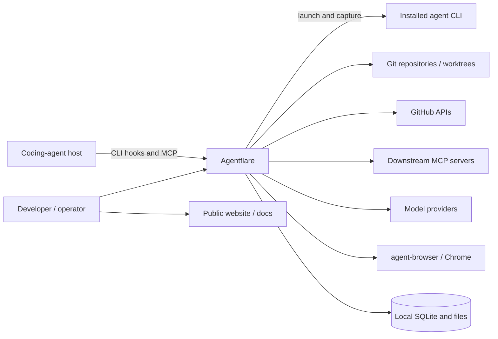
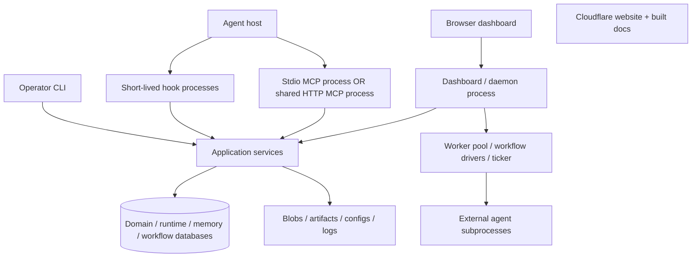
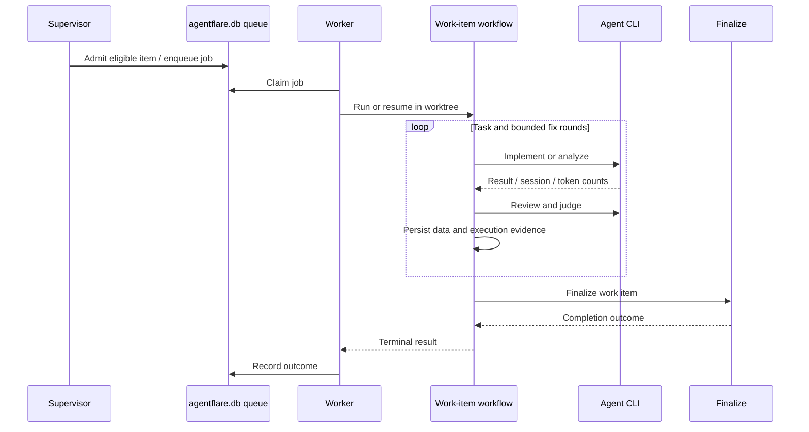
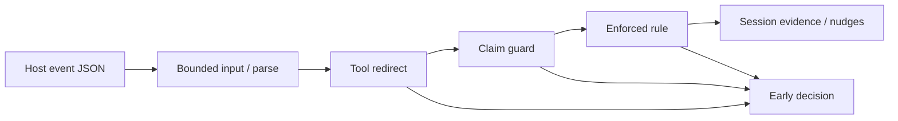
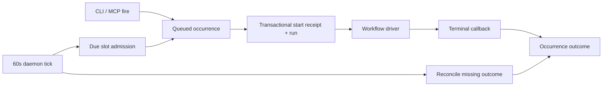
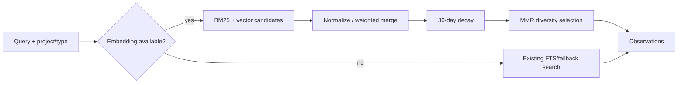

Adapted from the repository's [ARCHITECTURE.md](https://github.com/getappz/agentflare/blob/master/ARCHITECTURE.md). Source citations below retain the audited snapshot.

For current Codex setup, use `agentflare init --agent codex` alone. Installing the
Codex plugin as well duplicates lifecycle hooks; see [Getting started](/docs/getting-started/).

This document describes the local checkout inspected on **2026-10-26**, at
`a4e59d748a61dba653ff55e20052b09cb79376c9` on `docs/marketing-content`.
It documents existing behavior; it proposes no code modernization.
Source links point to the audited repository snapshot. `#L…` anchors identify lines in
the inspected snapshot; use the named symbol if later edits move a line.

## Part 1 — Technical deep dive

### Purpose and boundaries

Agentflare combines optimization for individual coding-agent sessions with a
local coordination system for work items, agent execution, review, messaging,
and durable workflows. The [README](https://github.com/getappz/agentflare/blob/a4e59d748a61dba653ff55e20052b09cb79376c9/README.md#what-this-is) describes that
product split. The implementation is a Rust CLI that also hosts MCP and HTTP
services; installed agents, Git, external tools, and model providers remain
separate programs or services. The root library exposes only `code`, rather
than all the binary's modules. [Sources: CLI dispatch](https://github.com/getappz/agentflare/blob/a4e59d748a61dba653ff55e20052b09cb79376c9/src/cli/mod.rs#L86),
[binary entry](https://github.com/getappz/agentflare/blob/a4e59d748a61dba653ff55e20052b09cb79376c9/src/main.rs#L96), [library facade](https://github.com/getappz/agentflare/blob/a4e59d748a61dba653ff55e20052b09cb79376c9/src/lib.rs).

### Product features and capabilities

This catalog describes **what a user or agent can accomplish**, separately from
the implementation map below. “Implemented” means a handler/command exists in
this snapshot; it does not mean an end-to-end run was tested here. CLI and MCP
coverage differ: a feature exposed by the `item` MCP tool is not necessarily an
`agentflare item` CLI subcommand. MCP names below are the server's base names;
clients can prefix them (for example, `mcp__flare__item`).
[CLI dispatch](https://github.com/getappz/agentflare/blob/a4e59d748a61dba653ff55e20052b09cb79376c9/src/cli/mod.rs#L86), [MCP tool definitions](https://github.com/getappz/agentflare/blob/a4e59d748a61dba653ff55e20052b09cb79376c9/src/mcp_server.rs#L1705).

#### Set up agents and improve individual sessions

| Capability / user outcome | Access and source | Conditions or limits |
|---|---|---|
| Connect an existing coding-agent host to Agentflare hooks, rules and MCP | CLI `init`, `doctor`; [installation flow](https://github.com/getappz/agentflare/blob/a4e59d748a61dba653ff55e20052b09cb79376c9/src/init.rs#L92) | Host support is not uniform. Configuration can be merged/refreshed; restart the host after setup. |
| Detect, install, update, remove and launch agent CLIs; name sessions and assign teams | CLI `agents list/doctor/install/update/uninstall/launch`, plus `run`; [agent actions](https://github.com/getappz/agentflare/blob/a4e59d748a61dba653ff55e20052b09cb79376c9/src/cli/agents.rs#L4) | External agent installations, their package managers and credentials remain prerequisites; Agentflare does not itself supply a coding model. |
| Compress a Markdown work product and recover a registered original later | CLI `optimize output compress`, `optimize retrieve`; [output command](https://github.com/getappz/agentflare/blob/a4e59d748a61dba653ff55e20052b09cb79376c9/src/cli/optimize.rs#L9), [retrieval](https://github.com/getappz/agentflare/blob/a4e59d748a61dba653ff55e20052b09cb79376c9/src/cli/optimize.rs#L519) | Compression uses an LLM. Omitted target means in-place output; the retrieval id refers to registered output-layer content, not arbitrary lean-ctx reads. |
| Apply code-minimalism, review, audit and related instruction playbooks | CLI `optimize code`; host hooks; [modes and previews](https://github.com/getappz/agentflare/blob/a4e59d748a61dba653ff55e20052b09cb79376c9/src/cli/optimize.rs#L114) | Several subcommands **print instructions for an agent**; their names do not mean the binary independently performed an audit or measured savings. |
| Rank transcript lines by relevance and receive runtime/session nudges | CLI `optimize context score`; lifecycle hooks; [score command](https://github.com/getappz/agentflare/blob/a4e59d748a61dba653ff55e20052b09cb79376c9/src/cli/optimize.rs#L529), [hook runtime](https://github.com/getappz/agentflare/blob/a4e59d748a61dba653ff55e20052b09cb79376c9/src/hook.rs#L504) | The compatibility `PreCompact` callback is inert. lean-ctx supplies separate tool-I/O/context functionality. |
| Add persistent coaching rules that appear at session start, on selected tools or when relevant to a prompt | CLI `coaching apply/list/remove/sync/enforce`; [actions](https://github.com/getappz/agentflare/blob/a4e59d748a61dba653ff55e20052b09cb79376c9/src/cli/coaching.rs#L5) | Enforcement requires the host's supported PreToolUse path; advisory text and hard-denied rules have different behavior. |

#### Remember work and find relevant information

| Capability / user outcome | Access and source | Conditions or limits |
|---|---|---|
| Preserve observations, decisions and session context across sessions; recall relevant notes | CLI `memory`; MCP `memory`; [memory modules](https://github.com/getappz/agentflare/blob/a4e59d748a61dba653ff55e20052b09cb79376c9/src/memory/mod.rs), [recall implementation](https://github.com/getappz/agentflare/blob/a4e59d748a61dba653ff55e20052b09cb79376c9/src/memory/search.rs#L106) | Local FTS is available without semantic embeddings; hybrid recall depends on the compiled feature and model availability. |
| Promote observations into a project lesson with execution receipts and explicit confidence | MCP `memory` promotion action; [validation](https://github.com/getappz/agentflare/blob/a4e59d748a61dba653ff55e20052b09cb79376c9/src/memory/promotion.rs#L23) | Requires live project-scoped evidence and a terminal run with recorded execution evidence. Provenance does not establish that the lesson is true. |
| Search local documents, memory and code, or query external information sources | MCP `search`; [actual dispatch](https://github.com/getappz/agentflare/blob/a4e59d748a61dba653ff55e20052b09cb79376c9/src/mcp_server/search.rs#L5), [request controls](https://github.com/getappz/agentflare/blob/a4e59d748a61dba653ff55e20052b09cb79376c9/src/mcp_server/types.rs#L1467) | `all` searches store+memory+code; `all+web` adds web. Other types include social, news, GitHub, academic, datasets, websites, weather, financial, crypto, FX, indicators, YouTube and Bluesky. Code search delegates to lean-ctx; external-source availability was not tested. |
| Retrieve/cache third-party package documentation, then search/list cached entries | CLI `docs`; MCP `flare_docs`; [lookup/cache flow](https://github.com/getappz/agentflare/blob/a4e59d748a61dba653ff55e20052b09cb79376c9/src/mcp_server/flare_docs.rs#L25) | Cache misses can trigger network fetches. This cache is distinct from project documents and cross-session memory. |
| Discover, load, install and share reusable skills; recommend skills for a repository | CLI `skill`; MCP `skill` search/load and `skill_create`; [CLI actions](https://github.com/getappz/agentflare/blob/a4e59d748a61dba653ff55e20052b09cb79376c9/src/cli/skill.rs#L14), [MCP requests](https://github.com/getappz/agentflare/blob/a4e59d748a61dba653ff55e20052b09cb79376c9/src/mcp_server/types.rs#L67) | CLI includes registry management, import/export, hub push/pull, search evaluation and provisioning. Provisioning is a dry run unless `--yes` is supplied. MCP search/load is narrower than the CLI. |

#### Plan, assign and execute a backlog

| Capability / user outcome | Access and source | Conditions or limits |
|---|---|---|
| Keep a shared backlog with projects, item states, assignees, labels, dates, parents, comments and typed dependencies | MCP `project`, `item`, `comment`, `label`; [item API](https://github.com/getappz/agentflare/blob/a4e59d748a61dba653ff55e20052b09cb79376c9/src/mcp_server.rs#L1705), [request fields](https://github.com/getappz/agentflare/blob/a4e59d748a61dba653ff55e20052b09cb79376c9/src/mcp_server/types.rs#L832) | Relations distinguish blocking dependencies from duplicates/related items. Projects can be archived to stop automatic dispatch/review while preserving readable data. [project behavior](https://github.com/getappz/agentflare/blob/a4e59d748a61dba653ff55e20052b09cb79376c9/src/mcp_server.rs#L1918) |
| Groom a backlog, produce standup/health reports and inspect a multi-project portfolio | MCP `pm` and `item` reporting actions; [PM implementation](https://github.com/getappz/agentflare/blob/a4e59d748a61dba653ff55e20052b09cb79376c9/src/mcp_server/pm.rs#L21) | Planning returns shortlist/Now/Next/Later buckets with a capacity parameter; business scoring such as RICE/WSJF remains the caller's job. This is not an autonomous product-prioritization engine. |
| Require a plan to be submitted and approved before implementation starts | MCP `item` actions `submit_plan`, `approve_plan`, `reject_plan`; [gate and transitions](https://github.com/getappz/agentflare/blob/a4e59d748a61dba653ff55e20052b09cb79376c9/src/mcp_server/item.rs#L208), [submission](https://github.com/getappz/agentflare/blob/a4e59d748a61dba653ff55e20052b09cb79376c9/src/mcp_server/item.rs#L1265) | Per-item plan policy must be configured; the existence of approval actions does not mean every item is gated. |
| Claim work without colliding with another session and provision an isolated worktree | MCP `item` claim/heartbeat/release; CLI `claim`; [claim implementation](https://github.com/getappz/agentflare/blob/a4e59d748a61dba653ff55e20052b09cb79376c9/src/mcp_server/item.rs#L1068) | Ownership has a liveness/TTL lifecycle. Worktree isolation and process sandboxing are separate guarantees. |
| Run work through implement/analyze, review, judge and finalization roles; discover and dispatch eligible work in the background | CLI `work` for operator dispatch; daemon supervisor; [work entry](https://github.com/getappz/agentflare/blob/a4e59d748a61dba653ff55e20052b09cb79376c9/src/cli/work.rs#L575), [pipeline](https://github.com/getappz/agentflare/blob/a4e59d748a61dba653ff55e20052b09cb79376c9/src/work_item_pipeline.rs#L482), [worker boot](https://github.com/getappz/agentflare/blob/a4e59d748a61dba653ff55e20052b09cb79376c9/src/dashboard/dispatch_boot.rs#L19) | Needs an installed/authenticated agent, eligible item and runnable project. The role loop has bounded fix/task counts. Automated results may require human follow-up. AI-agent callers are directed to item `redispatch` rather than recursively invoking `work`. [tool contract](https://github.com/getappz/agentflare/blob/a4e59d748a61dba653ff55e20052b09cb79376c9/src/mcp_server.rs#L1705) |
| Inspect progress, pause/resume/cancel work, or re-arm a failed item | CLI `item`, `job`; MCP `item` status/control/redispatch; dashboard controls; [control implementation](https://github.com/getappz/agentflare/blob/a4e59d748a61dba653ff55e20052b09cb79376c9/src/mcp_server/item.rs#L1967), [HTTP routes](https://github.com/getappz/agentflare/blob/a4e59d748a61dba653ff55e20052b09cb79376c9/src/dashboard/controls.rs#L73) | Pause retains resumable state/worktree; cancel is terminal. Item progress joins job, PR and daemon evidence rather than relying only on an agent's completion message. |
| Run a reusable JSON agent workflow, inspect its state/report, resolve a human wait, or cancel it | CLI `workflow`; MCP `workflow`; [tool contract](https://github.com/getappz/agentflare/blob/a4e59d748a61dba653ff55e20052b09cb79376c9/src/mcp_server.rs#L1949), [JSON runner](https://github.com/getappz/agentflare/blob/a4e59d748a61dba653ff55e20052b09cb79376c9/src/workflow.rs#L449) | Workflow execution is distinct from work-item dispatch. Cancelling does not compensate already-succeeded steps. |
| Execute a project workflow repeatedly on an interval or enqueue a manual occurrence | CLI `workflow schedule`; MCP workflow schedule actions; [scheduler contract](https://github.com/getappz/agentflare/blob/a4e59d748a61dba653ff55e20052b09cb79376c9/src/schedule/mod.rs#L1) | Minimum interval 60 seconds. `fire` queues work; the daemon executes it. Disable/remove does not cancel an already-claimed run. |

#### Review, collaborate and hand work off

| Capability / user outcome | Access and source | Conditions or limits |
|---|---|---|
| Collect review findings, verify cited changed lines, combine overlapping findings, and record acceptance-criterion verdicts | CLI `review`; MCP `review`; [consensus core](https://github.com/getappz/agentflare/blob/a4e59d748a61dba653ff55e20052b09cb79376c9/src/review.rs#L1), [request actions](https://github.com/getappz/agentflare/blob/a4e59d748a61dba653ff55e20052b09cb79376c9/src/mcp_server/types.rs#L183) | Citation verification/consensus does not prove every finding correct or that a patch has no bugs. Criteria without evidence cannot retain a pass verdict. |
| Create/manage PRs, issues, workflow runs and releases; preserve cross-instance PR ownership | CLI `git`, `pr`, `github-bridge`; MCP `flare_git`; [GitHub action schema](https://github.com/getappz/agentflare/blob/a4e59d748a61dba653ff55e20052b09cb79376c9/src/mcp_server/types.rs#L620), [supervisor](https://github.com/getappz/agentflare/blob/a4e59d748a61dba653ff55e20052b09cb79376c9/src/supervisor.rs) | GitHub credentials/policy are required. Supervisor discovery and review/repair are background policy paths, not a guarantee that a PR will be merged. |
| Send messages to sessions, teams, an item's worker, an agent kind or all live sessions | CLI `message`; MCP `message`; dashboard messages; [addressing and delivery contract](https://github.com/getappz/agentflare/blob/a4e59d748a61dba653ff55e20052b09cb79376c9/src/mcp_server.rs#L1719) | Delivery timing varies by marker and host hooks/MCP activity. Peer messages are not instructions from the user. |
| Pass a work product/context to another runtime and retain threaded handoff context | CLI `handoff`; MCP `handoff`; [handoff request](https://github.com/getappz/agentflare/blob/a4e59d748a61dba653ff55e20052b09cb79376c9/src/mcp_server/types.rs#L248) | The receiving runtime and delivery path must be available; handoff storage is separate from executing a new agent turn. |
| Publish versioned work products, compare versions, and attach files to items/projects | MCP `artifact`, `asset`; CLI `artifacts` for serving; [artifact actions/types](https://github.com/getappz/agentflare/blob/a4e59d748a61dba653ff55e20052b09cb79376c9/src/mcp_server/types.rs#L374), [asset entry](https://github.com/getappz/agentflare/blob/a4e59d748a61dba653ff55e20052b09cb79376c9/src/mcp_server.rs#L1932) | Asset attachment requires staging first. Artifact serving does not imply a public cloud deployment or authenticated sharing. |
| Capture workflow friction and notify external channels | CLI `vent`, `channel`; MCP vent/channel tools; [application modules](https://github.com/getappz/agentflare/blob/a4e59d748a61dba653ff55e20052b09cb79376c9/src/main.rs#L19), [MCP request types](https://github.com/getappz/agentflare/blob/a4e59d748a61dba653ff55e20052b09cb79376c9/src/mcp_server/types.rs#L173) | Channel delivery requires configured destinations/credentials; external delivery and auto-filing outcomes were not exercised here. |

#### Inspect sessions, operate tools and extend workflows

| Capability / user outcome | Access and source | Conditions or limits |
|---|---|---|
| View token/cost summaries and inspect/search/export historical agent sessions | CLI `cost`, `insights`; [insights actions](https://github.com/getappz/agentflare/blob/a4e59d748a61dba653ff55e20052b09cb79376c9/src/cli/insights.rs#L14) | Insights can sync/watch sources, show turns/tool calls, report statistics, export and generate handoff documents. Implemented ingest coverage is Claude/Codex/OpenCode; support for other installed hosts should not be inferred. [adapter scope](https://github.com/getappz/agentflare/blob/a4e59d748a61dba653ff55e20052b09cb79376c9/crates/flare-insights/src/lib.rs#L6) |
| Monitor boards, items, claims, jobs, messages and execution controls in a browser | CLI `serve`, `daemon`; [dashboard routes](https://github.com/getappz/agentflare/blob/a4e59d748a61dba653ff55e20052b09cb79376c9/src/dashboard/server.rs#L690) | Starting the dashboard can execute work. It is a local execution service with no general HTTP authentication, not just a reporting page. |
| Automate a browser using accessibility snapshots, element refs, actions, screenshots, PDFs and page reads | CLI `browser`; MCP `browser`; [command layer](https://github.com/getappz/agentflare/blob/a4e59d748a61dba653ff55e20052b09cb79376c9/src/cli/browser.rs#L1) | Needs the external browser backend/browser installation. Session identity defaults to the working directory; first use can download dependencies. |
| Discover a downstream MCP tool and invoke it through one gateway | MCP `tool` search/execute; [request schema](https://github.com/getappz/agentflare/blob/a4e59d748a61dba653ff55e20052b09cb79376c9/src/mcp_server/types.rs#L112), [gateway backends](https://github.com/getappz/agentflare/blob/a4e59d748a61dba653ff55e20052b09cb79376c9/crates/gateway-registry/src/lib.rs#L17) | Requires configured/reachable downstream servers and their authentication. This is tool discovery/routing, not a provider-independent guarantee about results. |
| Manage saved agent-auth profiles, rotations/cooldowns and project associations; store project secrets | CLI `auth`, `vault`; [auth actions](https://github.com/getappz/agentflare/blob/a4e59d748a61dba653ff55e20052b09cb79376c9/src/cli/auth.rs#L4), [vault actions](https://github.com/getappz/agentflare/blob/a4e59d748a61dba653ff55e20052b09cb79376c9/src/cli/vault.rs#L4) | Auth profiles and the secret vault are separate mechanisms. Provider quotas and login validity are external; clearing a local profile does not revoke a remote credential. |
| Inspect change impact and maintain worktrees/branches | CLI `code impact`, `git`, `clean`; [impact implementation](https://github.com/getappz/agentflare/blob/a4e59d748a61dba653ff55e20052b09cb79376c9/src/code/mod.rs#L45), [Git primitives](https://github.com/getappz/agentflare/blob/a4e59d748a61dba653ff55e20052b09cb79376c9/crates/flare-git-core/src/lib.rs#L1) | The impact implementation uses a Cargo workspace graph and reference checks; it is not a general whole-program analyzer for every language. Cleanup can mutate files/worktrees and must be reviewed. |
| Route Anthropic-style requests to configured alternate model providers | Dashboard `/proxy/v1/messages`; [proxy router](https://github.com/getappz/agentflare/blob/a4e59d748a61dba653ff55e20052b09cb79376c9/crates/flare-proxy/src/lib.rs#L18) | Needs upstream configuration/credentials; proxy token enforcement is conditional on configuration. Provider/model compatibility is not universally guaranteed. |
| Run an app packaged with its own manifest, tools and domain workflow | CLI `apps run`; [app entry](https://github.com/getappz/agentflare/blob/a4e59d748a61dba653ff55e20052b09cb79376c9/src/cli/apps.rs#L21), [app sender](https://github.com/getappz/agentflare/blob/a4e59d748a61dba653ff55e20052b09cb79376c9/src/workflow.rs#L276) | Existing surface runs an app directory. It does not establish a hosted app marketplace or independent multi-tenant app service. |

#### Product journeys and maturity

The capabilities compose into four main user journeys:

1. **Improve an individual session:** initialize a supported host, choose code
   instructions/coaching, recall prior memory, then use search/docs/skills as
   needed. Hook support and optional tooling determine the available experience.
2. **Deliver work from a shared backlog:** create and groom an item, approve its
   plan when required, dispatch it into a worktree, inspect/review the result,
   then confirm its PR merged before considering the work completed.
3. **Run a repeatable process:** define a project JSON workflow, run it directly
   or schedule it, resolve human waits, and inspect the durable execution report.
4. **Continue work across agents:** inspect the prior session, publish a durable
   artifact, hand off context or message the next session, and retain lessons
   with explicit evidence rather than promoting completion claims automatically.

These are compositions of the implemented paths above, not additional product
features. [STATUS.md](https://github.com/getappz/agentflare/blob/a4e59d748a61dba653ff55e20052b09cb79376c9/STATUS.md) describes optimization/memory/setup as more
settled and coordination/MCP formats as actively changing. **No blanket stability
rating or performance improvement is inferred from a feature's presence.**
This pass inspected handlers and successfully ran `--help` for agents, item, job,
work, review, skill, insights, apps, coaching, auth, vault, docs and pr; it did
not execute those workflows or contact their external services.

### Detected stack

| Layer | Technology | Evidence |
|---|---|---|
| Application | Rust 2024; package version 1.8.1; declared minimum Rust 1.91 | [Cargo.toml](https://github.com/getappz/agentflare/blob/a4e59d748a61dba653ff55e20052b09cb79376c9/Cargo.toml#L8) |
| Development toolchain | Rust 1.98.0, clippy, rustfmt | [rust-toolchain.toml](https://github.com/getappz/agentflare/blob/a4e59d748a61dba653ff55e20052b09cb79376c9/rust-toolchain.toml#L1) |
| CLI / serialization | clap 4 derive, serde, JSON, TOML | [Cargo.toml](https://github.com/getappz/agentflare/blob/a4e59d748a61dba653ff55e20052b09cb79376c9/Cargo.toml#L46) |
| Async / HTTP / MCP | Tokio 1, Axum 0.8, rmcp 1.8.0 with stdio and streamable HTTP | [Cargo.toml](https://github.com/getappz/agentflare/blob/a4e59d748a61dba653ff55e20052b09cb79376c9/Cargo.toml#L53), [MCP server](https://github.com/getappz/agentflare/blob/a4e59d748a61dba653ff55e20052b09cb79376c9/src/mcp_server.rs#L2184) |
| Persistence | Bundled SQLite through rusqlite 0.40; FTS5; per-subsystem migrations | [Cargo.toml](https://github.com/getappz/agentflare/blob/a4e59d748a61dba653ff55e20052b09cb79376c9/Cargo.toml#L66), [DB helper](https://github.com/getappz/agentflare/blob/a4e59d748a61dba653ff55e20052b09cb79376c9/crates/agentflare-db-kit/src/open.rs#L54), [memory search](https://github.com/getappz/agentflare/blob/a4e59d748a61dba653ff55e20052b09cb79376c9/src/memory/search.rs#L74) |
| Optional local embeddings | `semantic` feature forwards to store embeddings; ONNX model downloaded on first use | [Cargo.toml](https://github.com/getappz/agentflare/blob/a4e59d748a61dba653ff55e20052b09cb79376c9/Cargo.toml#L123), [memory engine](https://github.com/getappz/agentflare/blob/a4e59d748a61dba653ff55e20052b09cb79376c9/src/memory/engine.rs) |
| Dashboard | Embedded static assets, Axum JSON routes, server-sent events | [dashboard server](https://github.com/getappz/agentflare/blob/a4e59d748a61dba653ff55e20052b09cb79376c9/src/dashboard/server.rs#L1), [routes](https://github.com/getappz/agentflare/blob/a4e59d748a61dba653ff55e20052b09cb79376c9/src/dashboard/server.rs#L690) |
| Public website | Cloudflare Worker and static assets; Wrangler 4 | [site/package.json](https://github.com/getappz/agentflare/blob/a4e59d748a61dba653ff55e20052b09cb79376c9/site/package.json), [wrangler.jsonc](https://github.com/getappz/agentflare/blob/a4e59d748a61dba653ff55e20052b09cb79376c9/site/wrangler.jsonc#L1) |
| Documentation site | Astro 7.1.3 range, Starlight 0.41.4 range; mounted at `/docs` | [docs manifest](https://github.com/getappz/agentflare/blob/a4e59d748a61dba653ff55e20052b09cb79376c9/docs-site/package.json), [Astro config](https://github.com/getappz/agentflare/blob/a4e59d748a61dba653ff55e20052b09cb79376c9/docs-site/astro.config.mjs#L9) |
| JS task tooling | Two-member aube workspace; mise tasks | [aube-workspace.yaml](https://github.com/getappz/agentflare/blob/a4e59d748a61dba653ff55e20052b09cb79376c9/aube-workspace.yaml#L1), [mise.toml](https://github.com/getappz/agentflare/blob/a4e59d748a61dba653ff55e20052b09cb79376c9/mise.toml) |

`cargo metadata --offline --locked --no-deps --format-version 1` reported
**32 workspace packages**: the root package plus 31 explicitly listed members.
`flare-db` and `flare-db-macros` are deliberately excluded, with independent
database feature matrices and release lockfiles. Older documentation's
“28-member workspace” count was stale. [Source](https://github.com/getappz/agentflare/blob/a4e59d748a61dba653ff55e20052b09cb79376c9/Cargo.toml#L1).

### Entry points and process ownership

| Entry | Implementation and behavior |
|---|---|
| `agentflare <command>` | `main` installs error reporting, initializes mise PATH, parses clap, then dispatches through `Commands::run`. With no command it prints the about view. [main](https://github.com/getappz/agentflare/blob/a4e59d748a61dba653ff55e20052b09cb79376c9/src/main.rs#L96), [dispatch](https://github.com/getappz/agentflare/blob/a4e59d748a61dba653ff55e20052b09cb79376c9/src/cli/mod.rs#L192) |
| `agentflare hook … --agent …` | Short-lived host lifecycle handlers: session start/end, prompt, tool calls, failures, completion. Host wiring differs. [hook handlers](https://github.com/getappz/agentflare/blob/a4e59d748a61dba653ff55e20052b09cb79376c9/src/hook.rs), [Codex installation](https://github.com/getappz/agentflare/blob/a4e59d748a61dba653ff55e20052b09cb79376c9/src/init.rs#L644) |
| `agentflare mcp` | Stdio MCP server, ordinarily one process per client. It does not require the dashboard daemon. [implementation](https://github.com/getappz/agentflare/blob/a4e59d748a61dba653ff55e20052b09cb79376c9/src/mcp_server.rs#L2184) |
| `agentflare mcp --http` | Persistent shared `AgentflareMcp`, streamable HTTP at `/mcp`; default `127.0.0.1:35274`. No authentication is implemented here; the CLI documents the default Host allowlist. [options](https://github.com/getappz/agentflare/blob/a4e59d748a61dba653ff55e20052b09cb79376c9/src/cli/mcp.rs#L6), [server](https://github.com/getappz/agentflare/blob/a4e59d748a61dba653ff55e20052b09cb79376c9/src/mcp_server.rs#L2193) |
| `agentflare serve` / `agentflare daemon start` | Dashboard and execution host. Default `127.0.0.1:35273`; embedded assets, REST/SSE, worker pool, recovery, scheduler, supervisor, and proxy route. [serve](https://github.com/getappz/agentflare/blob/a4e59d748a61dba653ff55e20052b09cb79376c9/src/cli/serve.rs#L5), [boot](https://github.com/getappz/agentflare/blob/a4e59d748a61dba653ff55e20052b09cb79376c9/src/dashboard/server.rs#L770) |
| `site/src/worker.ts` | Separately deployed public website, serving `site/public`; docs are copied into those assets at deploy time. [Worker config](https://github.com/getappz/agentflare/blob/a4e59d748a61dba653ff55e20052b09cb79376c9/site/wrangler.jsonc#L1), [deploy scripts](https://github.com/getappz/agentflare/blob/a4e59d748a61dba653ff55e20052b09cb79376c9/site/package.json) |

**Resolved contradiction — the dashboard is not read-only.** CLI help still
calls it read-only, but its router accepts `POST /api/jobs`, messages, chat,
item/job controls, and gate reset. Startup can execute queued work and scheduled
workflows. Treat `serve` as starting the execution service, including when it
is launched only to view the UI. Non-loopback binding requires `--yes-expose`;
this is acknowledgement, not access control. [Routes](https://github.com/getappz/agentflare/blob/a4e59d748a61dba653ff55e20052b09cb79376c9/src/dashboard/server.rs#L690),
[controls](https://github.com/getappz/agentflare/blob/a4e59d748a61dba653ff55e20052b09cb79376c9/src/dashboard/controls.rs#L73), [messages](https://github.com/getappz/agentflare/blob/a4e59d748a61dba653ff55e20052b09cb79376c9/src/dashboard/messages.rs#L30),
[exposure check and startup](https://github.com/getappz/agentflare/blob/a4e59d748a61dba653ff55e20052b09cb79376c9/src/dashboard/server.rs#L770).

### Installation and first use

Installation commands below are verified against local scripts/configuration;
installations and downloads were **not executed** during this documentation pass.

| Path | Command | Actual behavior / requirements |
|---|---|---|
| Linux/macOS prebuilt | `curl -fsSL https://raw.githubusercontent.com/getappz/agentflare/master/install.sh \| sh` | Downloads a release outside a checkout; Linux GNU or macOS, x86_64/aarch64. Needs download/archive tools; default destination `~/.local/bin`. [installer](https://github.com/getappz/agentflare/blob/a4e59d748a61dba653ff55e20052b09cb79376c9/install.sh#L78) |
| Unix checkout | `sh ./install.sh` or `sh ./install.sh --build-only` | Runs `cargo build --release`; normal installation atomically replaces a symlink to the built binary. `--download` forces release download. [source path](https://github.com/getappz/agentflare/blob/a4e59d748a61dba653ff55e20052b09cb79376c9/install.sh#L192) |
| Windows checkout | `git clone https://github.com/getappz/agentflare.git`, then `cd agentflare`, then `.\install.ps1` | Requires Cargo and a working native Rust/linker toolchain. Builds `--release`, copies to `$CARGO_HOME/bin` or `~/.cargo/bin`; `-BuildOnly` skips the copy. [script](https://github.com/getappz/agentflare/blob/a4e59d748a61dba653ff55e20052b09cb79376c9/install.ps1#L47) |
| Cargo Git install | `cargo install --git https://github.com/getappz/agentflare` | Installs from source; root package is `publish = false`, so this is a Git install, not a crates.io root-package install. [manifest](https://github.com/getappz/agentflare/blob/a4e59d748a61dba653ff55e20052b09cb79376c9/Cargo.toml#L8), [README](https://github.com/getappz/agentflare/blob/a4e59d748a61dba653ff55e20052b09cb79376c9/README.md#install-the-cli) |
| Homebrew / Scoop | `brew tap getappz/agentflare` then `brew install agentflare`; or `scoop bucket add agentflare https://github.com/getappz/agentflare` then `scoop install agentflare` | Release automation generates package metadata. Remote package availability and installed behavior are [UNVERIFIED] here. [release workflow](https://github.com/getappz/agentflare/blob/a4e59d748a61dba653ff55e20052b09cb79376c9/.github/workflows/release.yml), [Scoop manifest](https://github.com/getappz/agentflare/blob/a4e59d748a61dba653ff55e20052b09cb79376c9/bucket/agentflare.json) |
| Agent integration | `agentflare init --agent codex` (or another supported host) | Checks/applies components, merges host hooks/config, can install missing tools and refresh rules. Restart the host afterward. [init](https://github.com/getappz/agentflare/blob/a4e59d748a61dba653ff55e20052b09cb79376c9/src/init.rs#L92), [components](https://github.com/getappz/agentflare/blob/a4e59d748a61dba653ff55e20052b09cb79376c9/src/components.rs#L713) |

Run `agentflare --version`, `agentflare init --help`, and `agentflare doctor`
to inspect the installed version, supported host choices, and wiring. Only
`--version` and help were run here; `doctor` is a diagnostic entry point verified
in [CLI dispatch](https://github.com/getappz/agentflare/blob/a4e59d748a61dba653ff55e20052b09cb79376c9/src/cli/mod.rs#L97).

Important installation distinctions:

- **Features differ:** source installers run `cargo build --release` without
  `semantic`; release CI builds with `--features semantic`. Use
  `cargo build --release --features semantic` for that feature in a local build.
  FTS remains available without embeddings. [Unix](https://github.com/getappz/agentflare/blob/a4e59d748a61dba653ff55e20052b09cb79376c9/install.sh#L205),
  [Windows](https://github.com/getappz/agentflare/blob/a4e59d748a61dba653ff55e20052b09cb79376c9/install.ps1#L75), [release](https://github.com/getappz/agentflare/blob/a4e59d748a61dba653ff55e20052b09cb79376c9/.github/workflows/release.yml#L46),
  [feature declaration](https://github.com/getappz/agentflare/blob/a4e59d748a61dba653ff55e20052b09cb79376c9/Cargo.toml#L123).
- **Checksums are conditional:** the Unix installer checks SHA-256 when
  `sha256sum` or `shasum` is available; it warns and skips verification if neither
  exists. Windows source installation does not download a release archive.
  Release CI generates checksums, cosign bundles, and a provenance job; signatures
  are not automatically verified by the source installers.
  [checksum code](https://github.com/getappz/agentflare/blob/a4e59d748a61dba653ff55e20052b09cb79376c9/install.sh#L101), [release pipeline](https://github.com/getappz/agentflare/blob/a4e59d748a61dba653ff55e20052b09cb79376c9/.github/workflows/release.yml#L98).
- **The binary is not every capability's only prerequisite:** lean-ctx is a
  separate integration; browser commands can install mise, a floating
  `agent-browser@latest`, and Chrome for Testing. `--no-auto-install` disables
  browser first-use installation. Agent execution additionally needs the selected
  agent and its credentials. [components](https://github.com/getappz/agentflare/blob/a4e59d748a61dba653ff55e20052b09cb79376c9/src/components.rs#L713),
  [browser installer](https://github.com/getappz/agentflare/blob/a4e59d748a61dba653ff55e20052b09cb79376c9/src/browser_install.rs#L1), [agent sender](https://github.com/getappz/agentflare/blob/a4e59d748a61dba653ff55e20052b09cb79376c9/src/workflow.rs#L66).
- **Setup updates existing configuration:** `init` is check-first, but it merges
  hook entries and can refresh managed rules; “nothing is created if it already
  exists” is not a complete description. Codex receives `~/.codex/hooks.json`
  lifecycle hooks as well as rules/MCP wiring. [init flow](https://github.com/getappz/agentflare/blob/a4e59d748a61dba653ff55e20052b09cb79376c9/src/init.rs#L92),
  [Codex hooks](https://github.com/getappz/agentflare/blob/a4e59d748a61dba653ff55e20052b09cb79376c9/src/init.rs#L644), [rule targets](https://github.com/getappz/agentflare/blob/a4e59d748a61dba653ff55e20052b09cb79376c9/src/components.rs#L287).
- **Windows install path assumption:** `install.ps1` looks specifically in
  `target/release/agentflare.exe`. A customized target directory may put the build
  elsewhere; unlike the Unix script, the Windows script does not resolve it via
  Cargo metadata. [Windows](https://github.com/getappz/agentflare/blob/a4e59d748a61dba653ff55e20052b09cb79376c9/install.ps1#L64), [Unix](https://github.com/getappz/agentflare/blob/a4e59d748a61dba653ff55e20052b09cb79376c9/install.sh#L206).

For removal, `install.sh --uninstall` removes binaries but leaves host
configuration behind. The separate `agentflare uninstall` CLI owns configuration
cleanup. [shell uninstall](https://github.com/getappz/agentflare/blob/a4e59d748a61dba653ff55e20052b09cb79376c9/install.sh#L233), [CLI](https://github.com/getappz/agentflare/blob/a4e59d748a61dba653ff55e20052b09cb79376c9/src/cli/mod.rs#L211).

### Commands and verification inventory

**S** = verified in local source/task configuration, **H** = help/parse surface
executed successfully, **R** = read-only command executed successfully.
S/H do not mean the build, installation, server, or workflow was exercised.
All commands run from the repository root unless stated otherwise.

| Command | Purpose | Evidence / verification |
|---|---|---|
| `agentflare --version`; `agentflare --help` | Installed binary identity and command inventory | R/H; observed `1.8.1 x86_64-pc-windows-msvc (2026-10-26)`; [clap entry](https://github.com/getappz/agentflare/blob/a4e59d748a61dba653ff55e20052b09cb79376c9/src/cli/mod.rs#L74) |
| `cargo metadata --offline --locked --no-deps --format-version 1` | Inspect workspace without dependency resolution/download | R; 32 packages; [workspace](https://github.com/getappz/agentflare/blob/a4e59d748a61dba653ff55e20052b09cb79376c9/Cargo.toml#L1) |
| `cargo build` | Default source development build | S; [contributor setup](https://github.com/getappz/agentflare/blob/a4e59d748a61dba653ff55e20052b09cb79376c9/CONTRIBUTING.md#setup) |
| `cargo build --release --features semantic` | Release-style native feature selection | S; [release.yml](https://github.com/getappz/agentflare/blob/a4e59d748a61dba653ff55e20052b09cb79376c9/.github/workflows/release.yml#L46) |
| `cargo run -- --help` | Run the source CLI after building | S; [binary target](https://github.com/getappz/agentflare/blob/a4e59d748a61dba653ff55e20052b09cb79376c9/Cargo.toml#L39), [entry](https://github.com/getappz/agentflare/blob/a4e59d748a61dba653ff55e20052b09cb79376c9/src/main.rs#L96) |
| `agentflare mcp`; `agentflare mcp --http` | Stdio / shared HTTP MCP | S/H; [CLI](https://github.com/getappz/agentflare/blob/a4e59d748a61dba653ff55e20052b09cb79376c9/src/cli/mcp.rs#L6); neither server started |
| `agentflare serve`; `agentflare daemon start` | Start execution/dashboard foreground / background | S/H for `serve`; [serve](https://github.com/getappz/agentflare/blob/a4e59d748a61dba653ff55e20052b09cb79376c9/src/cli/serve.rs#L27), [daemon command](https://github.com/getappz/agentflare/blob/a4e59d748a61dba653ff55e20052b09cb79376c9/src/cli/daemon.rs#L97); not started |
| `agentflare workflow run <file-or-name> --input "…"` | JSON workflow run | S/H; [resolver](https://github.com/getappz/agentflare/blob/a4e59d748a61dba653ff55e20052b09cb79376c9/src/workflow.rs#L393), [run implementation](https://github.com/getappz/agentflare/blob/a4e59d748a61dba653ff55e20052b09cb79376c9/src/workflow.rs#L449) |
| `agentflare workflow schedule create daily --workflow <name> --every 1d` | Register an interval schedule; template requires a real workflow name | S/H; [schedule CLI](https://github.com/getappz/agentflare/blob/a4e59d748a61dba653ff55e20052b09cb79376c9/src/cli/workflow.rs), [scheduler](https://github.com/getappz/agentflare/blob/a4e59d748a61dba653ff55e20052b09cb79376c9/src/schedule/mod.rs#L1) |
| `agentflare workflow schedule fire <name-or-id>` | Queue a manual occurrence for the daemon | S/H on parent schedule help; [schedule administration](https://github.com/getappz/agentflare/blob/a4e59d748a61dba653ff55e20052b09cb79376c9/src/schedule/admin.rs); not fired |
| `agentflare browser --help`; `agentflare optimize --help`; `agentflare flare --help` | Inspect browser and optimization surfaces; legacy `flare` alias | H; [dispatch](https://github.com/getappz/agentflare/blob/a4e59d748a61dba653ff55e20052b09cb79376c9/src/cli/mod.rs#L86); no browser or compression run |
| `.\install.ps1 -Help` | Windows installer usage without installing | H; [script](https://github.com/getappz/agentflare/blob/a4e59d748a61dba653ff55e20052b09cb79376c9/install.ps1#L38) |
| `mise run verify` | Local formatter, clippy, workspace tests | S; [mise task](https://github.com/getappz/agentflare/blob/a4e59d748a61dba653ff55e20052b09cb79376c9/mise.toml#L31); not run |
| `cargo fmt --check` | Rust formatting | S; [CI](https://github.com/getappz/agentflare/blob/a4e59d748a61dba653ff55e20052b09cb79376c9/.github/workflows/ci.yml#L199) |
| `cargo clippy --locked --workspace --all-targets --all-features -- -D warnings -A unsafe_code -A clippy::pedantic` | Type/lint gate across targets/features | S; [CI](https://github.com/getappz/agentflare/blob/a4e59d748a61dba653ff55e20052b09cb79376c9/.github/workflows/ci.yml#L179) |
| `cargo test --workspace` | Local workspace tests, including doctests | S; [mise](https://github.com/getappz/agentflare/blob/a4e59d748a61dba653ff55e20052b09cb79376c9/mise.toml#L31) |
| `cargo test -p agentflare-store retrieval::tests::single_bm25_result_normalizes_to_one -- --exact` | One existing unit test | S; [test](https://github.com/getappz/agentflare/blob/a4e59d748a61dba653ff55e20052b09cb79376c9/crates/agentflare-store/src/retrieval.rs#L131); not run |
| `cargo nextest run --workspace --verbose` | CI compilation and test binaries | S; [CI](https://github.com/getappz/agentflare/blob/a4e59d748a61dba653ff55e20052b09cb79376c9/.github/workflows/ci.yml#L129) |
| `cargo test --doc --workspace --verbose` | Doctests omitted by nextest | S; [CI](https://github.com/getappz/agentflare/blob/a4e59d748a61dba653ff55e20052b09cb79376c9/.github/workflows/ci.yml#L152) |
| `cargo hakari generate --diff`; `cargo hakari manage-deps --dry-run`; `cargo hakari verify` | Generated dependency-unification consistency | S; CI installs **cargo-hakari 0.9.38**; [CI](https://github.com/getappz/agentflare/blob/a4e59d748a61dba653ff55e20052b09cb79376c9/.github/workflows/ci.yml#L201) |
| CI's `EmbarkStudios/cargo-deny-action`; `cargo audit` | Dependency policy / advisories | S; cargo-deny action configuration in [CI](https://github.com/getappz/agentflare/blob/a4e59d748a61dba653ff55e20052b09cb79376c9/.github/workflows/ci.yml#L235), explicit audit command in [security workflow](https://github.com/getappz/agentflare/blob/a4e59d748a61dba653ff55e20052b09cb79376c9/.github/workflows/security-check.yml#L23); not run |
| `mise run install`; `mise run dev:site`; `mise run dev:docs`; `mise run build:docs` | aube dependency install, website/docs dev, docs build | S; [mise.toml](https://github.com/getappz/agentflare/blob/a4e59d748a61dba653ff55e20052b09cb79376c9/mise.toml#L1), [site](https://github.com/getappz/agentflare/blob/a4e59d748a61dba653ff55e20052b09cb79376c9/site/package.json), [docs](https://github.com/getappz/agentflare/blob/a4e59d748a61dba653ff55e20052b09cb79376c9/docs-site/package.json); not run |
| `mise run deploy` | Build docs, copy to website, deploy Worker | S; [mise](https://github.com/getappz/agentflare/blob/a4e59d748a61dba653ff55e20052b09cb79376c9/mise.toml#L22), [site scripts](https://github.com/getappz/agentflare/blob/a4e59d748a61dba653ff55e20052b09cb79376c9/site/package.json); publishes externally, not run |
| `git diff --check` | Whitespace/conflict-marker check for the documentation patch | R; also rerun at final verification |

**Resolved contradiction — local gate versus CI.** `mise run verify` covers the
same basic formatter/clippy/test concerns, but CI uses nextest plus a separate
doctest pass and adds hakari, cargo-deny, and the ambient target-directory guard.
It is not an exact reproduction of CI. The main build matrix runs Linux and
Windows for PRs, and Linux/macOS/Windows for other events. Expensive steps are
skipped for a successful docs-only path classification, but still report job
results; merge groups force code checks. [CI](https://github.com/getappz/agentflare/blob/a4e59d748a61dba653ff55e20052b09cb79376c9/.github/workflows/ci.yml#L25),
[local gate](https://github.com/getappz/agentflare/blob/a4e59d748a61dba653ff55e20052b09cb79376c9/mise.toml#L31).

CI runs on pushes to `master`, pull requests, and merge groups. `CI Green`
aggregates build, clippy, fmt, hakari, deny, and target-directory jobs. The
security workflow separately runs `cargo audit` on pushes/PRs and guards an
advisory exception's exact dependency chain. Source comments describe required
checks, but **actual GitHub branch-protection/required-check settings are
[UNVERIFIED]** from this local checkout. A workflow existing does not prove
that GitHub blocks a merge. [CI trigger](https://github.com/getappz/agentflare/blob/a4e59d748a61dba653ff55e20052b09cb79376c9/.github/workflows/ci.yml#L3),
[aggregate job](https://github.com/getappz/agentflare/blob/a4e59d748a61dba653ff55e20052b09cb79376c9/.github/workflows/ci.yml#L281),
[audit policy](https://github.com/getappz/agentflare/blob/a4e59d748a61dba653ff55e20052b09cb79376c9/.github/workflows/security-check.yml#L3).

There is no separate root JS typecheck, lint, or end-to-end task in the inspected
root/site/docs manifests. That is not a claim that the Rust suite has no
integration tests: [tests/](https://github.com/getappz/agentflare/tree/a4e59d748a61dba653ff55e20052b09cb79376c9/tests/) contains CLI integration tests, and unit
tests also live beside modules. No full test suite or external-agent end-to-end
run was performed for this documentation change.

### Directory and subsystem map

Directory names below are source locations, which sometimes differ from Cargo
package names (`flare-code` is packaged as `agentflare-flare-code`, for example).
[Root dependency aliases](https://github.com/getappz/agentflare/blob/a4e59d748a61dba653ff55e20052b09cb79376c9/Cargo.toml#L78).

| Area | Responsibility and primary source |
|---|---|
| `src/cli/`, `src/main.rs` | Command parsing and dispatch into application modules. [dispatch](https://github.com/getappz/agentflare/blob/a4e59d748a61dba653ff55e20052b09cb79376c9/src/cli/mod.rs#L192) |
| `src/mcp_server/`, `src/mcp_server.rs` | Tool adapters, request types, project scoping, lazy registries/stores, stdio/HTTP transport. [server state](https://github.com/getappz/agentflare/blob/a4e59d748a61dba653ff55e20052b09cb79376c9/src/mcp_server.rs#L127) |
| `src/init.rs`, `src/components.rs`, `src/hook*.rs`, `hooks/`, `.codex-plugin/` | Host configuration, lifecycle callbacks, guardrails, optional plugin packaging. [init](https://github.com/getappz/agentflare/blob/a4e59d748a61dba653ff55e20052b09cb79376c9/src/init.rs#L92), [hooks](https://github.com/getappz/agentflare/blob/a4e59d748a61dba653ff55e20052b09cb79376c9/src/hook.rs#L467) |
| `src/optimize/`, `crates/flare-code`, `crates/flare-output` | Code-minimalism instructions, prose compression, context scoring, reversible output retrieval and runtime nudges. [CLI surface](https://github.com/getappz/agentflare/blob/a4e59d748a61dba653ff55e20052b09cb79376c9/src/cli/mod.rs#L86), [context scorer](https://github.com/getappz/agentflare/blob/a4e59d748a61dba653ff55e20052b09cb79376c9/src/optimize/context.rs#L26) |
| `src/coaching/`, `src/memory/` | Persistent/contextual rules, observations, session memory, recall and evidence-backed lessons. [hook integration](https://github.com/getappz/agentflare/blob/a4e59d748a61dba653ff55e20052b09cb79376c9/src/hook.rs#L489), [recall](https://github.com/getappz/agentflare/blob/a4e59d748a61dba653ff55e20052b09cb79376c9/src/memory/search.rs#L106) |
| `crates/agentflare-backend` | Workspaces, projects, states, items, comments, labels, assignments, bridge registration and webhooks. [module inventory](https://github.com/getappz/agentflare/blob/a4e59d748a61dba653ff55e20052b09cb79376c9/crates/agentflare-backend/src/lib.rs), [schema registration](https://github.com/getappz/agentflare/blob/a4e59d748a61dba653ff55e20052b09cb79376c9/crates/agentflare-backend/src/db.rs#L11) |
| `src/claims.rs`, `src/sessions.rs`, `src/messages/`, `src/handoff/`, `src/review/` | Runtime ownership, live-session addressing, messaging, handoffs and review consensus. [DB migrations](https://github.com/getappz/agentflare/blob/a4e59d748a61dba653ff55e20052b09cb79376c9/src/db.rs#L21), [review core](https://github.com/getappz/agentflare/blob/a4e59d748a61dba653ff55e20052b09cb79376c9/src/review.rs#L1) |
| `src/work_item_pipeline*`, `src/supervisor/`, `src/cli/work/` | Item execution, SDD role loop, finalization, discovery and PR review/repair policy. [pipeline](https://github.com/getappz/agentflare/blob/a4e59d748a61dba653ff55e20052b09cb79376c9/src/work_item_pipeline.rs#L1103), [supervisor](https://github.com/getappz/agentflare/blob/a4e59d748a61dba653ff55e20052b09cb79376c9/src/supervisor.rs) |
| `crates/flare-workflow`, `src/workflow*`, `src/schedule/` | Generic workflow engine, JSON definitions, durable journal, execution leases, intervals and occurrence receipts. [engine](https://github.com/getappz/agentflare/blob/a4e59d748a61dba653ff55e20052b09cb79376c9/crates/flare-workflow/src/engine.rs#L196), [schedule](https://github.com/getappz/agentflare/blob/a4e59d748a61dba653ff55e20052b09cb79376c9/src/schedule/mod.rs#L1) |
| `crates/agentflare-jobs`, `crates/agentflare-resource-gate` | Persistent queue, subprocess/in-process executors, worker pool and resource-aware dispatch. [job types](https://github.com/getappz/agentflare/blob/a4e59d748a61dba653ff55e20052b09cb79376c9/crates/agentflare-jobs/src/types.rs#L7), [pool boot](https://github.com/getappz/agentflare/blob/a4e59d748a61dba653ff55e20052b09cb79376c9/src/dashboard/dispatch_boot.rs#L19) |
| `crates/flare-git-core`, `flare-git-shim`, `agentflare-shim`; `src/worktree/` | Local Git/worktree primitives, policy/provenance and PATH shims. `src/github/` separately owns remote GitHub APIs and bridge logic. [boundary](https://github.com/getappz/agentflare/blob/a4e59d748a61dba653ff55e20052b09cb79376c9/crates/flare-git-core/src/lib.rs#L1), [entry imports](https://github.com/getappz/agentflare/blob/a4e59d748a61dba653ff55e20052b09cb79376c9/src/main.rs#L45) |
| `crates/flare-sandbox`, `flare-process`, `agentflare-approval` | Process launch utilities, platform-dependent isolation and persisted human approval decisions. [sandbox](https://github.com/getappz/agentflare/blob/a4e59d748a61dba653ff55e20052b09cb79376c9/crates/flare-sandbox/src/lib.rs#L1), [approval gate](https://github.com/getappz/agentflare/blob/a4e59d748a61dba653ff55e20052b09cb79376c9/crates/agentflare-approval/src/lib.rs#L1) |
| `crates/agentflare-store`, `agentflare-db-kit`, `flare-search-kit` | Documents/blobs/KV/vectors, connection/migration helpers, shared search utilities. [store API](https://github.com/getappz/agentflare/blob/a4e59d748a61dba653ff55e20052b09cb79376c9/crates/agentflare-store/src/lib.rs#L1), [open helper](https://github.com/getappz/agentflare/blob/a4e59d748a61dba653ff55e20052b09cb79376c9/crates/agentflare-db-kit/src/open.rs#L1) |
| `crates/agent-registry`, `skill-registry`, `gateway-registry` | Agent registry, filesystem skill discovery/search, downstream MCP tool discovery and invocation. [manifest aliases](https://github.com/getappz/agentflare/blob/a4e59d748a61dba653ff55e20052b09cb79376c9/Cargo.toml#L78), [gateway exports](https://github.com/getappz/agentflare/blob/a4e59d748a61dba653ff55e20052b09cb79376c9/crates/gateway-registry/src/lib.rs#L17) |
| `crates/flare-docs` | Separately cached third-party API documentation; independent lifecycle from project documents. [store owner](https://github.com/getappz/agentflare/blob/a4e59d748a61dba653ff55e20052b09cb79376c9/src/mcp_server.rs#L209) |
| `crates/agentflare-artifacts`, `src/artifacts.rs`, `src/asset_store.rs` | Versioned artifact publishing/serving and project assets. [lazy artifact backend](https://github.com/getappz/agentflare/blob/a4e59d748a61dba653ff55e20052b09cb79376c9/src/mcp_server.rs#L147), [artifact routes](https://github.com/getappz/agentflare/blob/a4e59d748a61dba653ff55e20052b09cb79376c9/src/dashboard/artifacts.rs#L98) |
| `src/auth*`, `src/vault.rs`, `crates/flare-vault` | Auth profiles/rotation and encrypted project secrets, with distinct legacy/new vault paths. [auth cryptography](https://github.com/getappz/agentflare/blob/a4e59d748a61dba653ff55e20052b09cb79376c9/src/auth_crypt.rs#L1), [vault wrapper](https://github.com/getappz/agentflare/blob/a4e59d748a61dba653ff55e20052b09cb79376c9/src/vault.rs#L3) |
| `crates/flare-proxy`, `flare-consensus`, `flare-consensus-proxy` | Provider proxy and consensus-related libraries. Proxy HTTP is mounted by the dashboard; provider configuration can be supplied explicitly. [proxy](https://github.com/getappz/agentflare/blob/a4e59d748a61dba653ff55e20052b09cb79376c9/crates/flare-proxy/src/lib.rs#L18), [workspace](https://github.com/getappz/agentflare/blob/a4e59d748a61dba653ff55e20052b09cb79376c9/Cargo.toml#L2) |
| `crates/flare-browser`, `src/browser_install.rs`, `src/browser_decision.rs` | Browser command layer, first-use backend installation and observed-action decisions. [installer](https://github.com/getappz/agentflare/blob/a4e59d748a61dba653ff55e20052b09cb79376c9/src/browser_install.rs#L26), [CLI](https://github.com/getappz/agentflare/blob/a4e59d748a61dba653ff55e20052b09cb79376c9/src/cli/browser.rs) |
| `crates/flare-insights`, `src/cost.rs`, `src/rollup.rs` | Session ingest/search/replay/export and token/cost reporting. Insights explicitly lists Claude/Codex/OpenCode adapters, with other hosts incomplete. [insights modules](https://github.com/getappz/agentflare/blob/a4e59d748a61dba653ff55e20052b09cb79376c9/crates/flare-insights/src/lib.rs#L6) |
| `crates/agentflare-apps`, `apps/auto-company`, `src/cli/apps*` | App manifests, tools manifests and domain workflows using the workflow sender. [exports](https://github.com/getappz/agentflare/blob/a4e59d748a61dba653ff55e20052b09cb79376c9/crates/agentflare-apps/src/lib.rs), [app sender](https://github.com/getappz/agentflare/blob/a4e59d748a61dba653ff55e20052b09cb79376c9/src/workflow.rs#L276) |
| `crates/agentflare-config`, `agentflare-bin-lib`, `agentflare-workspace-hack` | Shared paths/config, binary support, generated dependency unification. [config API](https://github.com/getappz/agentflare/blob/a4e59d748a61dba653ff55e20052b09cb79376c9/crates/agentflare-config/src/lib.rs), [hakari gate](https://github.com/getappz/agentflare/blob/a4e59d748a61dba653ff55e20052b09cb79376c9/.github/workflows/ci.yml#L201) |
| `dashboard/web`, `docs-site`, `site` | Embedded application UI, separately built docs, public Worker website. [embedded UI](https://github.com/getappz/agentflare/blob/a4e59d748a61dba653ff55e20052b09cb79376c9/src/dashboard/server.rs#L1), [JS workspace](https://github.com/getappz/agentflare/blob/a4e59d748a61dba653ff55e20052b09cb79376c9/aube-workspace.yaml#L1) |
| `tests`, `.config`, `.githooks`, `.github`, `scripts` | Test executables/configuration, Git hooks, CI/release policy and maintenance scripts. [nextest config](https://github.com/getappz/agentflare/blob/a4e59d748a61dba653ff55e20052b09cb79376c9/.config/nextest.toml), [pre-commit](https://github.com/getappz/agentflare/blob/a4e59d748a61dba653ff55e20052b09cb79376c9/.githooks/pre-commit#L1) |

### Runtime and deployment surface

| Surface | Pin / selection | Implication and evidence |
|---|---|---|
| Native developer/build compiler | `rust-toolchain.toml`: **1.98.0**; manifest minimum **1.91** | Distinct toolchain pin and declared minimum; minimum-version compatibility was not tested. [toolchain](https://github.com/getappz/agentflare/blob/a4e59d748a61dba653ff55e20052b09cb79376c9/rust-toolchain.toml#L1), [manifest](https://github.com/getappz/agentflare/blob/a4e59d748a61dba653ff55e20052b09cb79376c9/Cargo.toml#L12) |
| CI compilation and linting | Build uses repository toolchain; fmt/clippy explicitly install floating `stable`; runner OS labels float | Potential version drift between compiler/linter environments is visible in [CI](https://github.com/getappz/agentflare/blob/a4e59d748a61dba653ff55e20052b09cb79376c9/.github/workflows/ci.yml#L80), [clippy setup](https://github.com/getappz/agentflare/blob/a4e59d748a61dba653ff55e20052b09cb79376c9/.github/workflows/ci.yml#L167) |
| Native releases | Linux GNU x86_64/aarch64, macOS x86_64/aarch64, Windows MSVC x86_64; semantic enabled | Linux ARM uses `cross`; no Linux musl or Windows ARM build in this matrix. [release matrix](https://github.com/getappz/agentflare/blob/a4e59d748a61dba653ff55e20052b09cb79376c9/.github/workflows/release.yml#L15) |
| Container | `debian:13-slim`, no digest; installer fetched from `master`; non-root user | The Dockerfile installs a release at build time, rather than building the checked-out Rust tree. Image tags alone do not pin the embedded binary version. [Dockerfile](https://github.com/getappz/agentflare/blob/a4e59d748a61dba653ff55e20052b09cb79376c9/Dockerfile#L1), [publish workflow](https://github.com/getappz/agentflare/blob/a4e59d748a61dba653ff55e20052b09cb79376c9/.github/workflows/docker.yml#L3) |
| Public Worker | `compatibility_date = 2025-04-01`; Wrangler `^4`; custom domains | Separate deployable from the native daemon. [config](https://github.com/getappz/agentflare/blob/a4e59d748a61dba653ff55e20052b09cb79376c9/site/wrangler.jsonc#L1), [manifest](https://github.com/getappz/agentflare/blob/a4e59d748a61dba653ff55e20052b09cb79376c9/site/package.json) |
| Documentation JS runtime | Astro/Starlight dependency ranges; aube `latest` in mise | No Node `engines` pin in the inspected root/site/docs manifests; aube lockfile records package resolution, not a fixed host runtime. [mise](https://github.com/getappz/agentflare/blob/a4e59d748a61dba653ff55e20052b09cb79376c9/mise.toml#L1), [docs manifest](https://github.com/getappz/agentflare/blob/a4e59d748a61dba653ff55e20052b09cb79376c9/docs-site/package.json) |
| Browser backend | `github:vercel-labs/agent-browser@latest` via mise; browser fetched by backend `install` | First use needs external downloads unless already provisioned. [installer](https://github.com/getappz/agentflare/blob/a4e59d748a61dba653ff55e20052b09cb79376c9/src/browser_install.rs#L19) |
| Database services | Bundled SQLite files, no external DB image required for the main binary | Do not infer PostgreSQL/MySQL requirements from the excluded `flare-db` libraries. [manifest](https://github.com/getappz/agentflare/blob/a4e59d748a61dba653ff55e20052b09cb79376c9/Cargo.toml#L3), [SQLite dependency](https://github.com/getappz/agentflare/blob/a4e59d748a61dba653ff55e20052b09cb79376c9/Cargo.toml#L66) |

### Dependency lifecycle and limitations

**[UNVERIFIED] EOL/maintenance status:** local manifests and lockfiles establish
versions, not present-day vendor support. No online lifecycle/advisory audit was
performed, and this document does not claim all dependencies are maintained or
free of vulnerabilities. Existing `KNOWN_ISSUES.md` dependency-health statements
are historical assertions, not current verification. The executable checks are
cargo-deny/cargo-audit; the latter includes a carefully scoped advisory exception.
[Security workflow](https://github.com/getappz/agentflare/blob/a4e59d748a61dba653ff55e20052b09cb79376c9/.github/workflows/security-check.yml#L23).

Concrete limitations visible in code:

- The compatibility `PreCompact` hook does nothing; it cannot make Claude Code
  retain scored transcript context. The standalone scorer still exists.
  [hook](https://github.com/getappz/agentflare/blob/a4e59d748a61dba653ff55e20052b09cb79376c9/src/hook.rs#L685), [scorer](https://github.com/getappz/agentflare/blob/a4e59d748a61dba653ff55e20052b09cb79376c9/src/optimize/context.rs#L26).
- Process isolation is enforced through Linux bubblewrap when available.
  Non-Linux `try_wrap` returns the plain command unless fail-closed policy is
  enabled, in which case it errors. This layer does not provide a Windows/macOS
  sandbox. [implementation](https://github.com/getappz/agentflare/blob/a4e59d748a61dba653ff55e20052b09cb79376c9/crates/flare-sandbox/src/lib.rs#L99).
- Daemon autostart installation supports macOS and Linux; other platforms return
  “autostart not supported”. This differs from manually starting the daemon.
  [autostart](https://github.com/getappz/agentflare/blob/a4e59d748a61dba653ff55e20052b09cb79376c9/src/daemon_autostart.rs#L4).
- Shared worktree `node_modules` use hard links with copy fallback and a matching
  lockfile requirement. In-place writes from an unsandboxed sharer can affect
  every sharer; the managed sandbox overlay is the protection.
  [dependency store](https://github.com/getappz/agentflare/blob/a4e59d748a61dba653ff55e20052b09cb79376c9/crates/flare-git-core/src/deps.rs#L1).
- Memory vector search scans and sorts eligible embeddings; it is not an ANN
  index. Recall scaling should be measured against actual observation volume.
  [candidate search](https://github.com/getappz/agentflare/blob/a4e59d748a61dba653ff55e20052b09cb79376c9/src/memory/embeddings.rs#L50).
- Work-item boot recovery uses default timeouts/extra arguments because the
  original dispatch values are not persisted. A failed workflow smoke test
  leaves the dashboard up with work dispatch off; schedule ticking is separate.
  [boot](https://github.com/getappz/agentflare/blob/a4e59d748a61dba653ff55e20052b09cb79376c9/src/dashboard/server.rs#L796), [ticker](https://github.com/getappz/agentflare/blob/a4e59d748a61dba653ff55e20052b09cb79376c9/src/dashboard/dispatch_boot.rs#L42).
- Job logs retain at most 64 MiB per stream; an explicit truncation marker is the
  indication, not a dedicated `JobOutput` flag. [job output](https://github.com/getappz/agentflare/blob/a4e59d748a61dba653ff55e20052b09cb79376c9/crates/agentflare-jobs/src/types.rs#L123).
- Coordination CLI/MCP/storage compatibility is still beta; a 1.x package version
  is not a whole-product stability contract. [STATUS.md](https://github.com/getappz/agentflare/blob/a4e59d748a61dba653ff55e20052b09cb79376c9/STATUS.md#versioning).

### Storage, APIs, extensions and background jobs

Paths below use `~/.agentflare` as the logical application home. Shared path
helpers include an override for isolated tests; platform-specific cache/data
locations are not necessarily under that directory.
[Paths](https://github.com/getappz/agentflare/blob/a4e59d748a61dba653ff55e20052b09cb79376c9/crates/agentflare-config/src/lib.rs#L14),
[binary support](https://github.com/getappz/agentflare/blob/a4e59d748a61dba653ff55e20052b09cb79376c9/crates/agentflare-bin-lib/src/paths.rs#L6).

| Store | Owner / contents / lifecycle |
|---|---|
| `backend.db` | Workspaces/projects/items/states/labels/comments and related domain state; separate append-only migration list. [open site](https://github.com/getappz/agentflare/blob/a4e59d748a61dba653ff55e20052b09cb79376c9/src/mcp_server.rs#L1057), [migrations](https://github.com/getappz/agentflare/blob/a4e59d748a61dba653ff55e20052b09cb79376c9/crates/agentflare-backend/src/db.rs#L5) |
| `agentflare.db` | Claims, sessions, messages, review findings, gateway secrets and job queue. Each subsystem owns its tables. The file's “single source of truth” comment applies to these relational domains, not every database in the product. [dispatcher](https://github.com/getappz/agentflare/blob/a4e59d748a61dba653ff55e20052b09cb79376c9/src/db.rs#L1), [queue open](https://github.com/getappz/agentflare/blob/a4e59d748a61dba653ff55e20052b09cb79376c9/src/dashboard/server.rs#L778) |
| `store.db`, `blobs-store/` | Documents, content-addressed blobs, vectors, KV, approvals and leases. Independent migrations; blob directory is namespaced by DB stem. [store path](https://github.com/getappz/agentflare/blob/a4e59d748a61dba653ff55e20052b09cb79376c9/crates/agentflare-bin-lib/src/store.rs#L4), [Store](https://github.com/getappz/agentflare/blob/a4e59d748a61dba653ff55e20052b09cb79376c9/crates/agentflare-store/src/lib.rs#L39) |
| `memory/brain.db` | Persistent memory observations, relations, sessions and summaries; WAL, normal synchronous mode and foreign keys. [open](https://github.com/getappz/agentflare/blob/a4e59d748a61dba653ff55e20052b09cb79376c9/src/memory/store.rs#L4), [modules](https://github.com/getappz/agentflare/blob/a4e59d748a61dba653ff55e20052b09cb79376c9/src/memory/mod.rs) |
| `workflows.db` | Generic/work-item workflow state and journals; interval schedules, occurrences and durable start receipts. [default path](https://github.com/getappz/agentflare/blob/a4e59d748a61dba653ff55e20052b09cb79376c9/src/workflow.rs#L54), [scheduler tables](https://github.com/getappz/agentflare/blob/a4e59d748a61dba653ff55e20052b09cb79376c9/src/schedule/mod.rs#L1) |
| `flare-docs.db` | Third-party package documentation cache, intentionally separate from project documents and with a separate blob namespace. [owner](https://github.com/getappz/agentflare/blob/a4e59d748a61dba653ff55e20052b09cb79376c9/src/mcp_server.rs#L209), [blob layout](https://github.com/getappz/agentflare/blob/a4e59d748a61dba653ff55e20052b09cb79376c9/crates/agentflare-store/src/lib.rs#L42) |
| Skill/gateway indexes | Lazily opened registries; filesystem/tool-derived indexes have refresh/cache lifecycles. These are not the item backend. [server fields](https://github.com/getappz/agentflare/blob/a4e59d748a61dba653ff55e20052b09cb79376c9/src/mcp_server.rs#L127), [gateway API](https://github.com/getappz/agentflare/blob/a4e59d748a61dba653ff55e20052b09cb79376c9/crates/gateway-registry/src/lib.rs#L17) |
| `vault.json`, auth profile files, runtime/config files | Secret storage and application state are not all SQL. Vault operations lock read/modify/write across processes. [vault](https://github.com/getappz/agentflare/blob/a4e59d748a61dba653ff55e20052b09cb79376c9/src/vault.rs#L18), [vault path](https://github.com/getappz/agentflare/blob/a4e59d748a61dba653ff55e20052b09cb79376c9/src/vault.rs#L77), [state support](https://github.com/getappz/agentflare/blob/a4e59d748a61dba653ff55e20052b09cb79376c9/crates/agentflare-bin-lib/src/state.rs) |

DB-kit opens files with a 5-second busy timeout, WAL, normal synchronous mode,
foreign-key enforcement and caller-owned migrations. It refuses databases newer
than the migration list known to the current binary (`SchemaAhead`); manually
rewriting `user_version` is not a schema downgrade.
[Implementation](https://github.com/getappz/agentflare/blob/a4e59d748a61dba653ff55e20052b09cb79376c9/crates/agentflare-db-kit/src/open.rs#L16).

MCP wraps the application in per-tool adapters and typed requests. Downstream
gateway integrations support stdio and HTTP MCP backends; skills supply
filesystem `SKILL.md` procedures; apps provide manifest/tools-driven workflow
modules. These are distinct extension mechanisms, not dynamically loaded Rust
plugins. [gateway exports](https://github.com/getappz/agentflare/blob/a4e59d748a61dba653ff55e20052b09cb79376c9/crates/gateway-registry/src/lib.rs#L17),
[app exports](https://github.com/getappz/agentflare/blob/a4e59d748a61dba653ff55e20052b09cb79376c9/crates/agentflare-apps/src/lib.rs), [application adapter](https://github.com/getappz/agentflare/blob/a4e59d748a61dba653ff55e20052b09cb79376c9/src/workflow.rs#L276).

Background execution belongs to the dashboard/daemon process: orphan
reconciliation, workflow recovery, job workers, discovery/review/approval sweeps,
resource sampling, schedule ticks, log cleanup, stale-job detection and binary
staleness restart. Stdio MCP can administer local data without that process,
but queued schedules require it to execute.
[Boot sequence](https://github.com/getappz/agentflare/blob/a4e59d748a61dba653ff55e20052b09cb79376c9/src/dashboard/server.rs#L770),
[work dispatch](https://github.com/getappz/agentflare/blob/a4e59d748a61dba653ff55e20052b09cb79376c9/src/dashboard/dispatch_boot.rs#L19),
[schedule ticker](https://github.com/getappz/agentflare/blob/a4e59d748a61dba653ff55e20052b09cb79376c9/src/dashboard/dispatch_boot.rs#L42).

## Part 2 — Checkout context and ecosystem

### Identity

| Field | Inspected value / evidence |
|---|---|
| Remote | `https://github.com/getappz/agentflare.git` (fetch/push); `git remote -v`; no embedded credentials |
| Branch | `docs/marketing-content`; `git branch --show-current` |
| HEAD | `a4e59d748a61dba653ff55e20052b09cb79376c9`; `git log -1`; “fix(supervisor): actionable PR comments when sweep will not merge” |
| Version | `1.8.1`; [manifest](https://github.com/getappz/agentflare/blob/a4e59d748a61dba653ff55e20052b09cb79376c9/Cargo.toml#L10); installed CLI reports the same version, but this alone does not prove byte-for-byte build identity |
| License | Apache-2.0; [Cargo.toml](https://github.com/getappz/agentflare/blob/a4e59d748a61dba653ff55e20052b09cb79376c9/Cargo.toml#L14), [LICENSE](https://github.com/getappz/agentflare/blob/a4e59d748a61dba653ff55e20052b09cb79376c9/LICENSE) |
| Verification host | Windows x86_64; Rust/Cargo 1.98.0, mise 2026.9.12, aube 2.2.17 observed from version commands |
| Working tree | Unrelated untracked files existed before this work; excluded from the documented implementation and left untouched |

**Resolved contradiction:** release-generated Homebrew/Scoop metadata still
contains `MIT` literals in the inspected workflow. Those literals do not change
the root package's Apache-2.0 declaration/license file; the packaging discrepancy
is recorded here, without modifying release automation.
[Release metadata generator](https://github.com/getappz/agentflare/blob/a4e59d748a61dba653ff55e20052b09cb79376c9/.github/workflows/release.yml), [license](https://github.com/getappz/agentflare/blob/a4e59d748a61dba653ff55e20052b09cb79376c9/LICENSE).

### Contributor and agent rules

- [AGENTS.md](https://github.com/getappz/agentflare/blob/a4e59d748a61dba653ff55e20052b09cb79376c9/AGENTS.md) requires lean-ctx code reads/search/shell, describes
  memory recall, optional mbx/shared dependency stores, and requires stamped
  PR creation via `agentflare pr open` rather than an unstamped manual PR.
  These are repository instructions; they are distinct from compiled policy.
- [CONTRIBUTING.md](https://github.com/getappz/agentflare/blob/a4e59d748a61dba653ff55e20052b09cb79376c9/CONTRIBUTING.md) provides setup, verification and CLA rules;
  [CLA.md](https://github.com/getappz/agentflare/blob/a4e59d748a61dba653ff55e20052b09cb79376c9/CLA.md) defines the contributor agreement.
- [.github/CODEOWNERS](https://github.com/getappz/agentflare/blob/a4e59d748a61dba653ff55e20052b09cb79376c9/.github/CODEOWNERS#L1) assigns all paths to `@getappz`;
  the [PR template](https://github.com/getappz/agentflare/blob/a4e59d748a61dba653ff55e20052b09cb79376c9/.github/pull_request_template.md) requests summary/test/risk
  details. Its shorter clippy command is not the complete current CI command.
- [.githooks/pre-commit](https://github.com/getappz/agentflare/blob/a4e59d748a61dba653ff55e20052b09cb79376c9/.githooks/pre-commit#L4) blocks default-branch commits
  when installed via `core.hooksPath`, chains an existing hook, and runs a staged
  Rust LOC gate. Branch-resolution errors fail open. A file's presence alone
  does not establish that a developer installed the hook.

### Developer gotchas

1. **Migration ownership matters.** Append backend migrations; do not edit old
   ones or combine independently versioned stores into a file. Installing a WIP
   binary with new migrations can prevent an older binary opening shared data.
   [backend rule](https://github.com/getappz/agentflare/blob/a4e59d748a61dba653ff55e20052b09cb79376c9/crates/agentflare-backend/src/db.rs#L5),
   [separate stores](https://github.com/getappz/agentflare/blob/a4e59d748a61dba653ff55e20052b09cb79376c9/crates/agentflare-bin-lib/src/store.rs#L4),
   [SchemaAhead](https://github.com/getappz/agentflare/blob/a4e59d748a61dba653ff55e20052b09cb79376c9/crates/agentflare-db-kit/src/open.rs#L16).
2. **Default builds differ from released binaries.** `semantic` is off by default;
   `skill-overrides-sync` is also optional and not part of released builds.
   Tests additionally use fast vault KDF parameters that the vault crate rejects
   in a release build. [features](https://github.com/getappz/agentflare/blob/a4e59d748a61dba653ff55e20052b09cb79376c9/Cargo.toml#L116),
   [release guard](https://github.com/getappz/agentflare/blob/a4e59d748a61dba653ff55e20052b09cb79376c9/crates/flare-vault/src/lib.rs#L3).
3. **A test pass under cargo is not identical to nextest.** Nextest config has
   retries and kill windows, including a larger override for a pause/resume test.
   Doctests run separately in CI. [nextest config](https://github.com/getappz/agentflare/blob/a4e59d748a61dba653ff55e20052b09cb79376c9/.config/nextest.toml#L37),
   [CI test steps](https://github.com/getappz/agentflare/blob/a4e59d748a61dba653ff55e20052b09cb79376c9/.github/workflows/ci.yml#L129).
4. **Build artifacts need deliberate isolation.** Dispatched agents optionally
   prepend the mbx cargo shim, with plain Cargo fallback. CI instead uses sccache
   and rejects ambient target-directory overrides. This inspection's Cargo
   metadata resolved a user-global target directory; no build was run against it.
   [mbx](https://github.com/getappz/agentflare/blob/a4e59d748a61dba653ff55e20052b09cb79376c9/src/mbx.rs#L1), [CI guard](https://github.com/getappz/agentflare/blob/a4e59d748a61dba653ff55e20052b09cb79376c9/.github/workflows/ci.yml#L250).
5. **Website deployment assumes Unix utilities.** `copy:docs` uses `rm -rf` and
   `cp -R`; do not assume this task runs in bare PowerShell. Docs are mounted at
   `/docs`; their build is separate from the embedded dashboard UI.
   [site scripts](https://github.com/getappz/agentflare/blob/a4e59d748a61dba653ff55e20052b09cb79376c9/site/package.json), [Astro base](https://github.com/getappz/agentflare/blob/a4e59d748a61dba653ff55e20052b09cb79376c9/docs-site/astro.config.mjs#L4).

The broader ecosystem visible on disk includes agent-host integrations,
downstream MCP servers, GitHub, model providers, channel integrations, browser
automation and the independent public website. No sibling repository internals,
live service availability, benchmark reproduction or release-install history
was used as evidence. Marketing performance numbers in README remain attributed
claims, not measurements made by this architecture pass.
[Host components](https://github.com/getappz/agentflare/blob/a4e59d748a61dba653ff55e20052b09cb79376c9/src/components.rs#L713), [gateway](https://github.com/getappz/agentflare/blob/a4e59d748a61dba653ff55e20052b09cb79376c9/crates/gateway-registry/src/lib.rs),
[proxy](https://github.com/getappz/agentflare/blob/a4e59d748a61dba653ff55e20052b09cb79376c9/crates/flare-proxy/src/lib.rs#L18), [README metrics](https://github.com/getappz/agentflare/blob/a4e59d748a61dba653ff55e20052b09cb79376c9/README.md#metrics).

## Part 3 — Architectural blueprint

### Level 1: system context

Context edges reflect [command modules](https://github.com/getappz/agentflare/blob/a4e59d748a61dba653ff55e20052b09cb79376c9/src/main.rs#L1),
[MCP transports](https://github.com/getappz/agentflare/blob/a4e59d748a61dba653ff55e20052b09cb79376c9/src/mcp_server.rs#L2184), [agent sender](https://github.com/getappz/agentflare/blob/a4e59d748a61dba653ff55e20052b09cb79376c9/src/workflow.rs#L66),
[browser installer](https://github.com/getappz/agentflare/blob/a4e59d748a61dba653ff55e20052b09cb79376c9/src/browser_install.rs#L26) and [website config](https://github.com/getappz/agentflare/blob/a4e59d748a61dba653ff55e20052b09cb79376c9/site/wrangler.jsonc).

### Level 2: containers and processes

These are deployment/process boundaries, not a set of mandatory always-running
microservices. CLI/hooks/MCP share libraries; the optional daemon owns persistent
execution loops. [MCP setup](https://github.com/getappz/agentflare/blob/a4e59d748a61dba653ff55e20052b09cb79376c9/src/cli/mcp.rs#L22),
[server boot](https://github.com/getappz/agentflare/blob/a4e59d748a61dba653ff55e20052b09cb79376c9/src/dashboard/server.rs#L770), [workspace](https://github.com/getappz/agentflare/blob/a4e59d748a61dba653ff55e20052b09cb79376c9/Cargo.toml#L1).

### Level 3: representative work-item lifecycle

This summarizes [discovery](https://github.com/getappz/agentflare/blob/a4e59d748a61dba653ff55e20052b09cb79376c9/src/supervisor.rs#L508),
[dispatch boot](https://github.com/getappz/agentflare/blob/a4e59d748a61dba653ff55e20052b09cb79376c9/src/dashboard/dispatch_boot.rs#L19),
[pipeline construction](https://github.com/getappz/agentflare/blob/a4e59d748a61dba653ff55e20052b09cb79376c9/src/work_item_pipeline.rs#L1103),
[role execution](https://github.com/getappz/agentflare/blob/a4e59d748a61dba653ff55e20052b09cb79376c9/src/work_item_pipeline.rs#L482) and
[finalization](https://github.com/getappz/agentflare/blob/a4e59d748a61dba653ff55e20052b09cb79376c9/src/work_item_pipeline/finalize.rs#L59).

### Layering and dependency rules

The root binary composes service modules and workspace crates. CLI and MCP
adapters call into common implementation; local Git primitives are shared with
the Git shim, while remote GitHub calls live separately. Database owners supply
their own migration list to DB-kit. These boundaries are explicit in modules
and Cargo dependencies; no general architecture/import-boundary checker was
established in this inspection. [dispatch](https://github.com/getappz/agentflare/blob/a4e59d748a61dba653ff55e20052b09cb79376c9/src/cli/mod.rs#L192),
[Git boundary](https://github.com/getappz/agentflare/blob/a4e59d748a61dba653ff55e20052b09cb79376c9/crates/flare-git-core/src/lib.rs#L1),
[DB-kit boundary](https://github.com/getappz/agentflare/blob/a4e59d748a61dba653ff55e20052b09cb79376c9/crates/agentflare-db-kit/src/open.rs#L1).

MCP caches lazily opened registries/connections. A standard mutex protects a
synchronous skills registry; a Tokio mutex protects the async gateway registry
so no standard guard is held across an await. Project-scoped views share the
backend connection but can pin project identity explicitly.
[Server fields](https://github.com/getappz/agentflare/blob/a4e59d748a61dba653ff55e20052b09cb79376c9/src/mcp_server.rs#L127),
[project-scoped constructor](https://github.com/getappz/agentflare/blob/a4e59d748a61dba653ff55e20052b09cb79376c9/src/mcp_server.rs#L986).

### Cross-cutting concerns

| Concern | Existing implementation / limits |
|---|---|
| Configuration | Global paths/config helpers, host settings merges, project workflow files, environment-driven providers. [paths](https://github.com/getappz/agentflare/blob/a4e59d748a61dba653ff55e20052b09cb79376c9/crates/agentflare-config/src/lib.rs), [init](https://github.com/getappz/agentflare/blob/a4e59d748a61dba653ff55e20052b09cb79376c9/src/init.rs#L92), [workflow resolution](https://github.com/getappz/agentflare/blob/a4e59d748a61dba653ff55e20052b09cb79376c9/src/workflow.rs#L393) |
| Credentials / secrets | Legacy auth encryption uses AES-256-GCM plus PBKDF2-HMAC-SHA256 (600,000 production iterations); project vault delegates to `flare-vault` and zeroizes cached passphrases. These are distinct formats, not one universal vault. [auth crypt](https://github.com/getappz/agentflare/blob/a4e59d748a61dba653ff55e20052b09cb79376c9/src/auth_crypt.rs#L7), [vault wrapper](https://github.com/getappz/agentflare/blob/a4e59d748a61dba653ff55e20052b09cb79376c9/src/vault.rs#L3) |
| HTTP access | Dashboard has no general authentication; nonlocal binding requires acknowledgement. MCP HTTP also documents no auth. Proxy has a token gate only when `AGENTFLARE_PROXY_TOKEN` is set. [dashboard](https://github.com/getappz/agentflare/blob/a4e59d748a61dba653ff55e20052b09cb79376c9/src/dashboard/server.rs#L770), [MCP](https://github.com/getappz/agentflare/blob/a4e59d748a61dba653ff55e20052b09cb79376c9/src/cli/mcp.rs#L15), [proxy](https://github.com/getappz/agentflare/blob/a4e59d748a61dba653ff55e20052b09cb79376c9/crates/flare-proxy/src/lib.rs#L50) |
| Authorization / policy | Hook redirects/claim guards/enforced coaching rules can deny tool calls; approval library classifies actions and persists prompt decisions with expiry. Coverage depends on the invoking surface; this is not proof every subprocess is gated. [pre-tool flow](https://github.com/getappz/agentflare/blob/a4e59d748a61dba653ff55e20052b09cb79376c9/src/hook.rs#L467), [approval](https://github.com/getappz/agentflare/blob/a4e59d748a61dba653ff55e20052b09cb79376c9/crates/agentflare-approval/src/lib.rs#L1) |
| Errors | Typed `thiserror` DB/store errors, MCP `ErrorData`, CLI errors and nonzero exits; no universal single error type. [store errors](https://github.com/getappz/agentflare/blob/a4e59d748a61dba653ff55e20052b09cb79376c9/crates/agentflare-store/src/lib.rs#L21), [backend open adapter](https://github.com/getappz/agentflare/blob/a4e59d748a61dba653ff55e20052b09cb79376c9/src/mcp_server.rs#L1057), [MCP CLI](https://github.com/getappz/agentflare/blob/a4e59d748a61dba653ff55e20052b09cb79376c9/src/cli/mcp.rs#L26) |
| Observability | Workflow events/journals, job stream files, dashboard SSE, session analytics; no production telemetry service is required by these local paths. [engine](https://github.com/getappz/agentflare/blob/a4e59d748a61dba653ff55e20052b09cb79376c9/crates/flare-workflow/src/engine.rs#L196), [job output](https://github.com/getappz/agentflare/blob/a4e59d748a61dba653ff55e20052b09cb79376c9/crates/agentflare-jobs/src/types.rs#L123), [insights](https://github.com/getappz/agentflare/blob/a4e59d748a61dba653ff55e20052b09cb79376c9/crates/flare-insights/src/lib.rs#L6) |
| Feature flags | Cargo `semantic`, `skill-overrides-sync`; explicit test-only KDF feature; environment switches for browser/proxy/sandbox paths. [features](https://github.com/getappz/agentflare/blob/a4e59d748a61dba653ff55e20052b09cb79376c9/Cargo.toml#L116), [vault guard](https://github.com/getappz/agentflare/blob/a4e59d748a61dba653ff55e20052b09cb79376c9/crates/flare-vault/src/lib.rs#L3), [sandbox](https://github.com/getappz/agentflare/blob/a4e59d748a61dba653ff55e20052b09cb79376c9/crates/flare-sandbox/src/lib.rs#L99) |
| Compatibility | Defaulted serialized `AgentJob.in_process` preserves old jobs; newer-schema DBs are refused; coordination formats remain beta. [job field](https://github.com/getappz/agentflare/blob/a4e59d748a61dba653ff55e20052b09cb79376c9/crates/agentflare-jobs/src/types.rs#L34), [SchemaAhead](https://github.com/getappz/agentflare/blob/a4e59d748a61dba653ff55e20052b09cb79376c9/crates/agentflare-db-kit/src/open.rs#L16), [status](https://github.com/getappz/agentflare/blob/a4e59d748a61dba653ff55e20052b09cb79376c9/STATUS.md) |

### Deep dive 1: host integration and hook policy

`Component` entries provide `check`/`apply` behavior. `init` evaluates those
entries, then wires host-specific lifecycle callbacks. Codex receives session
start/end, prompt, pre/post tool and stop hooks, plus code-optimization events;
other hosts use different APIs/settings. This is why a new component and a new
host are different changes. [registry API](https://github.com/getappz/agentflare/blob/a4e59d748a61dba653ff55e20052b09cb79376c9/src/components.rs#L16),
[init](https://github.com/getappz/agentflare/blob/a4e59d748a61dba653ff55e20052b09cb79376c9/src/init.rs#L92), [Codex wiring](https://github.com/getappz/agentflare/blob/a4e59d748a61dba653ff55e20052b09cb79376c9/src/init.rs#L644).

For a pre-tool call, input is read and parsed; the handler first evaluates tool
redirection, then work-item claim guard, then enforced coaching rules. A decision
can return immediately. Remaining processing updates session-scoped runtime
tracking and nudges. Session evidence is keyed by agent identity plus session
identity so one agent's verification cannot satisfy another agent's gate.
[Ordering and session key](https://github.com/getappz/agentflare/blob/a4e59d748a61dba653ff55e20052b09cb79376c9/src/hook.rs#L467).

The diagram follows [pre_tool_use](https://github.com/getappz/agentflare/blob/a4e59d748a61dba653ff55e20052b09cb79376c9/src/hook.rs#L467). Hook support and installed
configuration are part of correctness: native host events differ, and the
compatibility `pre_compact` function is explicitly empty. Do not treat the
existence of a hook name as evidence that it injects context.
[No-op and rationale](https://github.com/getappz/agentflare/blob/a4e59d748a61dba653ff55e20052b09cb79376c9/src/hook.rs#L685).

### Deep dive 2: jobs, durable workflows and schedules

There are three different state models:

| Model | Role / state |
|---|---|
| `AgentJob` / `JobState` | Queue/execution envelope: queued, running, exited, killed, failed. Jobs can be subprocesses or in-process work-item executors. [types](https://github.com/getappz/agentflare/blob/a4e59d748a61dba653ff55e20052b09cb79376c9/crates/agentflare-jobs/src/types.rs#L7) |
| `WorkflowState<D>` / `WorkflowContext<D>` | Typed workflow data, per-step state, journal, budget, execution lease and lifecycle. SQLite serialization maps workflow statuses to pending/running/waiting/paused/completed/failed/cancelled. [types](https://github.com/getappz/agentflare/blob/a4e59d748a61dba653ff55e20052b09cb79376c9/crates/flare-workflow/src/types.rs#L386), [status mapping](https://github.com/getappz/agentflare/blob/a4e59d748a61dba653ff55e20052b09cb79376c9/crates/flare-workflow/src/sqlite_store.rs#L330) |
| Schedule occurrence | Durable admission/start/outcome record, linked to a workflow run; administrative clients enqueue while the daemon executes. [scheduler contract](https://github.com/getappz/agentflare/blob/a4e59d748a61dba653ff55e20052b09cb79376c9/src/schedule/mod.rs#L1) |

Workflow start looks up a registered definition, creates a run id and state,
initializes budget and lease, claims the in-process driving guard, saves state,
appends input/params to the journal, and spawns the driver. The engine has both
an in-process driving set and renewable ownership leases to coordinate recovery.
[Engine fields](https://github.com/getappz/agentflare/blob/a4e59d748a61dba653ff55e20052b09cb79376c9/crates/flare-workflow/src/engine.rs#L196),
[start](https://github.com/getappz/agentflare/blob/a4e59d748a61dba653ff55e20052b09cb79376c9/crates/flare-workflow/src/engine.rs#L414).

The journal records ordered execution entries/results for replay. **[INFERRED]
external side effects still need idempotency:** replaying a pending entry after
a crash cannot, by itself, prove that an upstream API call never happened.
The stronger schedule admission path uses SQLite's specialized start-once API:
receipt, initial run state and input journal commit together; only the receipt
creator launches a driver. Repeating the same key returns its original run id,
even after workflow-history eviction. This is narrower than a blanket
“exactly-once external execution” guarantee.
[Journal](https://github.com/getappz/agentflare/blob/a4e59d748a61dba653ff55e20052b09cb79376c9/crates/flare-workflow/src/journal.rs#L1),
[start-once contract](https://github.com/getappz/agentflare/blob/a4e59d748a61dba653ff55e20052b09cb79376c9/crates/flare-workflow/src/engine_start_once.rs#L73).

The work-item pipeline consists of `sdd_loop` followed by `finalize`.
`WorkItemData` carries task progress, implementer/reviewer identities and agent
sessions across turns. It checkpoints progress; the role loop invokes
implementer/analyst, reviewer and judge paths, wraps sending with budget checks,
and uses explicit ceilings of five fix rounds and 50 processed tasks.
[construction](https://github.com/getappz/agentflare/blob/a4e59d748a61dba653ff55e20052b09cb79376c9/src/work_item_pipeline.rs#L1103),
[data](https://github.com/getappz/agentflare/blob/a4e59d748a61dba653ff55e20052b09cb79376c9/src/work_item_pipeline.rs#L43), [ceilings](https://github.com/getappz/agentflare/blob/a4e59d748a61dba653ff55e20052b09cb79376c9/src/work_item_pipeline.rs#L341),
[role loop](https://github.com/getappz/agentflare/blob/a4e59d748a61dba653ff55e20052b09cb79376c9/src/work_item_pipeline.rs#L482).

Boot orders recovery before fresh dispatch: reconcile queue orphans, smoke-test
the workflow store, register the work-item definition, recover eligible runs,
then start workers and supervisor ticks. Recovery errors retry every 60 seconds;
smoke-test/registration failure leaves work dispatch off while the UI remains
available. The schedule ticker starts independently.
[Boot](https://github.com/getappz/agentflare/blob/a4e59d748a61dba653ff55e20052b09cb79376c9/src/dashboard/server.rs#L784), [retry](https://github.com/getappz/agentflare/blob/a4e59d748a61dba653ff55e20052b09cb79376c9/src/dashboard/dispatch_boot.rs#L118).

Schedules resolve project-local `.agentflare/workflows/<name>.json`, use UTC epoch
seconds and a minimum 60-second interval. Manual `fire` only enqueues; a disabled
schedule can still receive a manual fire. Disable/remove do not cancel a claimed
run. The ticker runs every 60 seconds, including an initial immediate tick,
with missed ticks skipped. Paused runs continue blocking overlap. Retention is
100 non-skip terminal occurrences plus a separate 100 skip rows per schedule;
active rows and start receipts are not discarded by those caps.
[scheduler constants](https://github.com/getappz/agentflare/blob/a4e59d748a61dba653ff55e20052b09cb79376c9/src/schedule/mod.rs#L34),
[administration](https://github.com/getappz/agentflare/blob/a4e59d748a61dba653ff55e20052b09cb79376c9/src/schedule/admin.rs), [ticker](https://github.com/getappz/agentflare/blob/a4e59d748a61dba653ff55e20052b09cb79376c9/src/dashboard/dispatch_boot.rs#L83),
[documented lifecycle](https://github.com/getappz/agentflare/blob/a4e59d748a61dba653ff55e20052b09cb79376c9/README.md#workflow-schedules).

Sources: [ticker](https://github.com/getappz/agentflare/blob/a4e59d748a61dba653ff55e20052b09cb79376c9/src/dashboard/dispatch_boot.rs#L60),
[receipt](https://github.com/getappz/agentflare/blob/a4e59d748a61dba653ff55e20052b09cb79376c9/crates/flare-workflow/src/engine_start_once.rs#L73),
[terminal callback](https://github.com/getappz/agentflare/blob/a4e59d748a61dba653ff55e20052b09cb79376c9/crates/flare-workflow/src/engine_start_once.rs#L20).

### Deep dive 3: memory, documents and retrieval

Memory observations live in `memory/brain.db`; project documents/blobs live in
`store.db`; third-party docs use `flare-docs.db`. Keeping the three separate
avoids migration-version conflicts and gives caches different lifecycles.
Blob paths are also separated by database stem so one store's garbage collector
cannot delete another store's referenced content.
[Memory open](https://github.com/getappz/agentflare/blob/a4e59d748a61dba653ff55e20052b09cb79376c9/src/memory/store.rs#L4),
[store boundary](https://github.com/getappz/agentflare/blob/a4e59d748a61dba653ff55e20052b09cb79376c9/crates/agentflare-bin-lib/src/store.rs#L4),
[docs boundary](https://github.com/getappz/agentflare/blob/a4e59d748a61dba653ff55e20052b09cb79376c9/src/mcp_server.rs#L209),
[blob namespace](https://github.com/getappz/agentflare/blob/a4e59d748a61dba653ff55e20052b09cb79376c9/crates/agentflare-store/src/lib.rs#L42).

Memory hybrid recall first attempts query embedding. If unavailable, it returns
the existing lexical search directly. Otherwise it obtains lexical and vector
candidates, normalizes and merges scores with weights **0.4 BM25 / 0.6 vector**,
applies **30-day half-life** decay, then selects diverse results using **MMR
lambda 0.7** and text Jaccard similarity. Empty candidate results use the existing
fallback search. These constants describe memory recall, not every search tool
in the repository. [hybrid search](https://github.com/getappz/agentflare/blob/a4e59d748a61dba653ff55e20052b09cb79376c9/src/memory/search.rs#L102),
[shared math](https://github.com/getappz/agentflare/blob/a4e59d748a61dba653ff55e20052b09cb79376c9/crates/agentflare-store/src/retrieval.rs#L7).

Evidence-backed lessons are an explicit promotion path rather than automatic
conversion of raw observations into authority. Promotion requires a terminal
workflow run with recorded execution evidence, project-scoped live supporting
observations, and confidence in `(0,1]`. Provenance proves the receipt exists;
it does not establish the semantic truth of the lesson. The promotion code
records immutable evidence relations and exposes effective confidence.
[Validation](https://github.com/getappz/agentflare/blob/a4e59d748a61dba653ff55e20052b09cb79376c9/src/memory/promotion.rs#L23),
[promotion and views](https://github.com/getappz/agentflare/blob/a4e59d748a61dba653ff55e20052b09cb79376c9/src/memory/promotion.rs#L48).

### Inferred architectural decisions

These are reconstructed explanations, not historical ADRs approved by the author.

| Decision | Rationale inferred from implementation |
|---|---|
| [INFERRED] Share a native core across interaction surfaces | CLI, MCP and daemon compose the same Rust services to reduce divergent behavior. [dispatch](https://github.com/getappz/agentflare/blob/a4e59d748a61dba653ff55e20052b09cb79376c9/src/cli/mod.rs#L192), [server](https://github.com/getappz/agentflare/blob/a4e59d748a61dba653ff55e20052b09cb79376c9/src/mcp_server.rs#L127) |
| [INFERRED] Keep operation local-first | SQLite/files allow standalone CLI/MCP use without a mandatory remote control plane. External services remain capability-specific dependencies. [storage opens](https://github.com/getappz/agentflare/blob/a4e59d748a61dba653ff55e20052b09cb79376c9/src/db.rs#L21), [stdio](https://github.com/getappz/agentflare/blob/a4e59d748a61dba653ff55e20052b09cb79376c9/src/mcp_server.rs#L2184) |
| [INFERRED] Separate schema owners and cache lifecycles | Independent migration lists and blob namespaces avoid schema/GC collisions. [store rationale](https://github.com/getappz/agentflare/blob/a4e59d748a61dba653ff55e20052b09cb79376c9/crates/agentflare-bin-lib/src/store.rs#L4), [blob rationale](https://github.com/getappz/agentflare/blob/a4e59d748a61dba653ff55e20052b09cb79376c9/crates/agentflare-store/src/lib.rs#L42) |
| [INFERRED] Gate fresh work on recoverable execution state | Recovery precedes dispatch; start receipts and execution leases handle competing/restarted drivers. [boot](https://github.com/getappz/agentflare/blob/a4e59d748a61dba653ff55e20052b09cb79376c9/src/dashboard/server.rs#L796), [lease fields](https://github.com/getappz/agentflare/blob/a4e59d748a61dba653ff55e20052b09cb79376c9/crates/flare-workflow/src/engine.rs#L215) |
| [INFERRED] Degrade optional capabilities explicitly | No embedding means lexical recall; absent mbx means Cargo; absent enforcing sandbox may mean unsandboxed fallback unless configured fail-closed. [recall](https://github.com/getappz/agentflare/blob/a4e59d748a61dba653ff55e20052b09cb79376c9/src/memory/search.rs#L116), [mbx](https://github.com/getappz/agentflare/blob/a4e59d748a61dba653ff55e20052b09cb79376c9/src/mbx.rs#L1), [sandbox](https://github.com/getappz/agentflare/blob/a4e59d748a61dba653ff55e20052b09cb79376c9/crates/flare-sandbox/src/lib.rs#L99) |

### Governance, release and feature changes

CI's aggregate job, dependency/advisory workflows, CODEOWNERS, CLA workflow and
native Git hooks supply different checks; none alone proves remote merge
protection is enabled. Release builds trigger on `v*` tags, package native
targets, generate checksums/signatures/provenance, update package metadata and
dispatch other publication workflows. Docker publishes to GHCR via a separate
workflow. Release workflow configuration was inspected; successful publishing,
signature validation and currently available releases are [UNVERIFIED].
[CI](https://github.com/getappz/agentflare/blob/a4e59d748a61dba653ff55e20052b09cb79376c9/.github/workflows/ci.yml), [CLA workflow](https://github.com/getappz/agentflare/blob/a4e59d748a61dba653ff55e20052b09cb79376c9/.github/workflows/cla.yml),
[release](https://github.com/getappz/agentflare/blob/a4e59d748a61dba653ff55e20052b09cb79376c9/.github/workflows/release.yml#L1), [Docker publication](https://github.com/getappz/agentflare/blob/a4e59d748a61dba653ff55e20052b09cb79376c9/.github/workflows/docker.yml).

To add a feature within the existing architecture:

1. Locate the owning service/crate, then trace its callers before changing it.
   Put command parsing in `src/cli`; extend the corresponding MCP adapter/types
   only if the feature must be available through MCP. The root library is not a
   general re-export facade. [CLI dispatch](https://github.com/getappz/agentflare/blob/a4e59d748a61dba653ff55e20052b09cb79376c9/src/cli/mod.rs#L192), [lib](https://github.com/getappz/agentflare/blob/a4e59d748a61dba653ff55e20052b09cb79376c9/src/lib.rs),
   [MCP adapter directory](https://github.com/getappz/agentflare/tree/a4e59d748a61dba653ff55e20052b09cb79376c9/src/mcp_server/).
2. Add persistent domain changes to the correct migration owner. Append backend
   migrations and preserve serialized compatibility for stored jobs/workflows.
   Use isolated DB/path seams in tests rather than a developer's real stores.
   [backend migration rule](https://github.com/getappz/agentflare/blob/a4e59d748a61dba653ff55e20052b09cb79376c9/crates/agentflare-backend/src/db.rs#L5),
   [job compatibility](https://github.com/getappz/agentflare/blob/a4e59d748a61dba653ff55e20052b09cb79376c9/crates/agentflare-jobs/src/types.rs#L34),
   [MCP test overrides](https://github.com/getappz/agentflare/blob/a4e59d748a61dba653ff55e20052b09cb79376c9/src/mcp_server.rs#L173).
3. For managed integration, add/check the component and required host wiring.
   For execution features, account for lease loss, restart, cancellation, budget
   and terminal outcomes; a queue row is not a workflow run.
   [components](https://github.com/getappz/agentflare/blob/a4e59d748a61dba653ff55e20052b09cb79376c9/src/components.rs#L713),
   [engine state](https://github.com/getappz/agentflare/blob/a4e59d748a61dba653ff55e20052b09cb79376c9/crates/flare-workflow/src/engine.rs#L196).
4. Run the relevant focused tests, then the local verification task and any
   feature-specific CI gates. Update help/docs, manifest aliases and generated
   hakari output when the change touches them. Open a stamped PR using repository
   instructions. [command inventory](#commands-and-verification-inventory),
   [AGENTS.md](https://github.com/getappz/agentflare/blob/a4e59d748a61dba653ff55e20052b09cb79376c9/AGENTS.md), [hakari](https://github.com/getappz/agentflare/blob/a4e59d748a61dba653ff55e20052b09cb79376c9/.github/workflows/ci.yml#L201).

### Confidence and verification boundaries

| Claim area | Confidence | Boundary |
|---|---|---|
| Snapshot, package membership, installed CLI help/version | High | Read from Git/manifests; metadata/help/version commands executed |
| Process topology, routes, database ownership and hook order | High | Direct source inspection; no server boot or host-hook integration test |
| Command spellings and CI/task definitions | High | Local declarations plus selected CLI help; builds/tests not executed |
| Workflow, scheduler and recall internals | High for described implementation | Source read; concurrency/crash/power-loss behavior not fault-injected |
| Rationale in inferred ADRs; external-side-effect idempotency caveat | Inferred | Architectural reasoning, explicitly marked |
| Fresh installs, release downloads, external tools/services and provider auth | Unverified | No install/download/live-agent execution performed |
| Remote required checks, branch protection, published artifacts and lifecycle/EOL | Unverified | Not established by local source; no remote lookup performed |
| Performance/benchmark claims | Unverified in this pass | No benchmark rerun; historical marketing/audit claims not promoted to measurements |

Documentation verification checks local link targets/line bounds, key section
coverage and patch whitespace. No application behavior, dependency, schema or
runtime configuration is changed by this documentation pass.

### Source index

- [Cargo.toml](https://github.com/getappz/agentflare/blob/a4e59d748a61dba653ff55e20052b09cb79376c9/Cargo.toml), [rust-toolchain.toml](https://github.com/getappz/agentflare/blob/a4e59d748a61dba653ff55e20052b09cb79376c9/rust-toolchain.toml): package identity, workspace boundaries, features and compiler pin.
- [src/main.rs](https://github.com/getappz/agentflare/blob/a4e59d748a61dba653ff55e20052b09cb79376c9/src/main.rs), [src/cli/mod.rs](https://github.com/getappz/agentflare/blob/a4e59d748a61dba653ff55e20052b09cb79376c9/src/cli/mod.rs): binary and command entry points.
- [src/init.rs](https://github.com/getappz/agentflare/blob/a4e59d748a61dba653ff55e20052b09cb79376c9/src/init.rs), [src/components.rs](https://github.com/getappz/agentflare/blob/a4e59d748a61dba653ff55e20052b09cb79376c9/src/components.rs), [src/hook.rs](https://github.com/getappz/agentflare/blob/a4e59d748a61dba653ff55e20052b09cb79376c9/src/hook.rs): integration installation and lifecycle policy.
- [src/mcp_server.rs](https://github.com/getappz/agentflare/blob/a4e59d748a61dba653ff55e20052b09cb79376c9/src/mcp_server.rs), [src/cli/mcp.rs](https://github.com/getappz/agentflare/blob/a4e59d748a61dba653ff55e20052b09cb79376c9/src/cli/mcp.rs): MCP ownership, state and transports.
- [src/dashboard/server.rs](https://github.com/getappz/agentflare/blob/a4e59d748a61dba653ff55e20052b09cb79376c9/src/dashboard/server.rs), [dispatch_boot.rs](https://github.com/getappz/agentflare/blob/a4e59d748a61dba653ff55e20052b09cb79376c9/src/dashboard/dispatch_boot.rs): routes, execution hosting and recovery ordering.
- [src/work_item_pipeline.rs](https://github.com/getappz/agentflare/blob/a4e59d748a61dba653ff55e20052b09cb79376c9/src/work_item_pipeline.rs), [src/supervisor.rs](https://github.com/getappz/agentflare/blob/a4e59d748a61dba653ff55e20052b09cb79376c9/src/supervisor.rs): item orchestration and review/repair dispatch.
- [flare-workflow engine](https://github.com/getappz/agentflare/blob/a4e59d748a61dba653ff55e20052b09cb79376c9/crates/flare-workflow/src/engine.rs), [start-once](https://github.com/getappz/agentflare/blob/a4e59d748a61dba653ff55e20052b09cb79376c9/crates/flare-workflow/src/engine_start_once.rs), [journal](https://github.com/getappz/agentflare/blob/a4e59d748a61dba653ff55e20052b09cb79376c9/crates/flare-workflow/src/journal.rs): durable execution primitives.
- [src/schedule/mod.rs](https://github.com/getappz/agentflare/blob/a4e59d748a61dba653ff55e20052b09cb79376c9/src/schedule/mod.rs), [src/schedule/admin.rs](https://github.com/getappz/agentflare/blob/a4e59d748a61dba653ff55e20052b09cb79376c9/src/schedule/admin.rs): schedule storage and admission semantics.
- [DB-kit](https://github.com/getappz/agentflare/blob/a4e59d748a61dba653ff55e20052b09cb79376c9/crates/agentflare-db-kit/src/open.rs), [backend migrations](https://github.com/getappz/agentflare/blob/a4e59d748a61dba653ff55e20052b09cb79376c9/crates/agentflare-backend/src/db.rs), [store](https://github.com/getappz/agentflare/blob/a4e59d748a61dba653ff55e20052b09cb79376c9/crates/agentflare-store/src/lib.rs): database contracts.
- [memory search](https://github.com/getappz/agentflare/blob/a4e59d748a61dba653ff55e20052b09cb79376c9/src/memory/search.rs), [memory embeddings](https://github.com/getappz/agentflare/blob/a4e59d748a61dba653ff55e20052b09cb79376c9/src/memory/embeddings.rs), [promotion](https://github.com/getappz/agentflare/blob/a4e59d748a61dba653ff55e20052b09cb79376c9/src/memory/promotion.rs): retrieval and lesson evidence.
- [sandbox](https://github.com/getappz/agentflare/blob/a4e59d748a61dba653ff55e20052b09cb79376c9/crates/flare-sandbox/src/lib.rs), [dependency sharing](https://github.com/getappz/agentflare/blob/a4e59d748a61dba653ff55e20052b09cb79376c9/crates/flare-git-core/src/deps.rs): platform and shared-file limits.
- [install.sh](https://github.com/getappz/agentflare/blob/a4e59d748a61dba653ff55e20052b09cb79376c9/install.sh), [install.ps1](https://github.com/getappz/agentflare/blob/a4e59d748a61dba653ff55e20052b09cb79376c9/install.ps1), [release.yml](https://github.com/getappz/agentflare/blob/a4e59d748a61dba653ff55e20052b09cb79376c9/.github/workflows/release.yml): install/release differences.
- [mise.toml](https://github.com/getappz/agentflare/blob/a4e59d748a61dba653ff55e20052b09cb79376c9/mise.toml), [ci.yml](https://github.com/getappz/agentflare/blob/a4e59d748a61dba653ff55e20052b09cb79376c9/.github/workflows/ci.yml), [security-check.yml](https://github.com/getappz/agentflare/blob/a4e59d748a61dba653ff55e20052b09cb79376c9/.github/workflows/security-check.yml): executable verification inventory.
- [site/package.json](https://github.com/getappz/agentflare/blob/a4e59d748a61dba653ff55e20052b09cb79376c9/site/package.json), [Worker config](https://github.com/getappz/agentflare/blob/a4e59d748a61dba653ff55e20052b09cb79376c9/site/wrangler.jsonc), [docs config](https://github.com/getappz/agentflare/blob/a4e59d748a61dba653ff55e20052b09cb79376c9/docs-site/astro.config.mjs): separate website/docs build and deployment.
