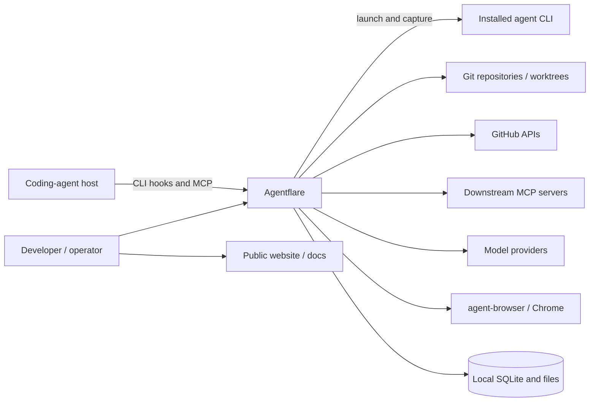
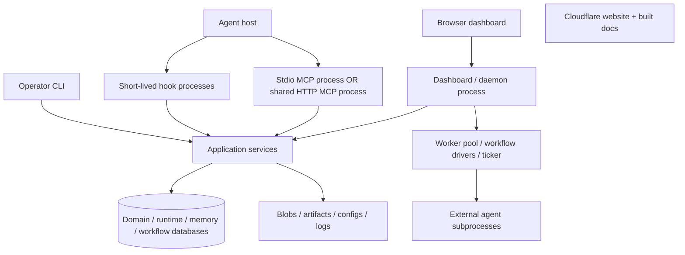
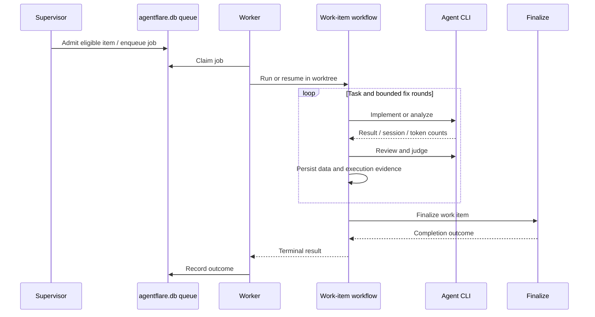
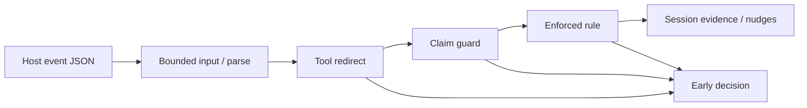
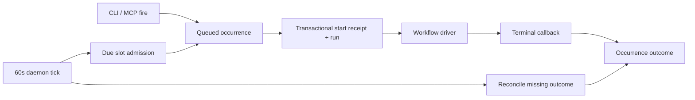
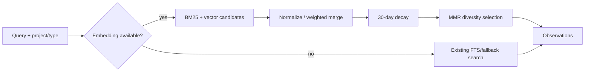

## Level 1: system context

Context edges reflect [command modules](https://github.com/getappz/agentflare/blob/a4e59d748a61dba653ff55e20052b09cb79376c9/src/main.rs#L1),
[MCP transports](https://github.com/getappz/agentflare/blob/a4e59d748a61dba653ff55e20052b09cb79376c9/src/mcp_server.rs#L2184), [agent sender](https://github.com/getappz/agentflare/blob/a4e59d748a61dba653ff55e20052b09cb79376c9/src/workflow.rs#L66),
[browser installer](https://github.com/getappz/agentflare/blob/a4e59d748a61dba653ff55e20052b09cb79376c9/src/browser_install.rs#L26) and [website config](https://github.com/getappz/agentflare/blob/a4e59d748a61dba653ff55e20052b09cb79376c9/site/wrangler.jsonc).

## Level 2: containers and processes

These are deployment/process boundaries, not a set of mandatory always-running
microservices. CLI/hooks/MCP share libraries; the optional daemon owns persistent
execution loops. [MCP setup](https://github.com/getappz/agentflare/blob/a4e59d748a61dba653ff55e20052b09cb79376c9/src/cli/mcp.rs#L22),
[server boot](https://github.com/getappz/agentflare/blob/a4e59d748a61dba653ff55e20052b09cb79376c9/src/dashboard/server.rs#L770), [workspace](https://github.com/getappz/agentflare/blob/a4e59d748a61dba653ff55e20052b09cb79376c9/Cargo.toml#L1).

## Level 3: representative work-item lifecycle

This summarizes [discovery](https://github.com/getappz/agentflare/blob/a4e59d748a61dba653ff55e20052b09cb79376c9/src/supervisor.rs#L508),
[dispatch boot](https://github.com/getappz/agentflare/blob/a4e59d748a61dba653ff55e20052b09cb79376c9/src/dashboard/dispatch_boot.rs#L19),
[pipeline construction](https://github.com/getappz/agentflare/blob/a4e59d748a61dba653ff55e20052b09cb79376c9/src/work_item_pipeline.rs#L1103),
[role execution](https://github.com/getappz/agentflare/blob/a4e59d748a61dba653ff55e20052b09cb79376c9/src/work_item_pipeline.rs#L482) and
[finalization](https://github.com/getappz/agentflare/blob/a4e59d748a61dba653ff55e20052b09cb79376c9/src/work_item_pipeline/finalize.rs#L59).

## Layering and dependency rules

The root binary composes service modules and workspace crates. CLI and MCP
adapters call into common implementation; local Git primitives are shared with
the Git shim, while remote GitHub calls live separately. Database owners supply
their own migration list to DB-kit. These boundaries are explicit in modules
and Cargo dependencies; no general architecture/import-boundary checker was
established in this inspection. [dispatch](https://github.com/getappz/agentflare/blob/a4e59d748a61dba653ff55e20052b09cb79376c9/src/cli/mod.rs#L192),
[Git boundary](https://github.com/getappz/agentflare/blob/a4e59d748a61dba653ff55e20052b09cb79376c9/crates/flare-git-core/src/lib.rs#L1),
[DB-kit boundary](https://github.com/getappz/agentflare/blob/a4e59d748a61dba653ff55e20052b09cb79376c9/crates/agentflare-db-kit/src/open.rs#L1).

MCP caches lazily opened registries/connections. A standard mutex protects a
synchronous skills registry; a Tokio mutex protects the async gateway registry
so no standard guard is held across an await. Project-scoped views share the
backend connection but can pin project identity explicitly.
[Server fields](https://github.com/getappz/agentflare/blob/a4e59d748a61dba653ff55e20052b09cb79376c9/src/mcp_server.rs#L127),
[project-scoped constructor](https://github.com/getappz/agentflare/blob/a4e59d748a61dba653ff55e20052b09cb79376c9/src/mcp_server.rs#L986).

## Cross-cutting concerns

| Concern | Existing implementation / limits |
|---|---|
| Configuration | Global paths/config helpers, host settings merges, project workflow files, environment-driven providers. [paths](https://github.com/getappz/agentflare/blob/a4e59d748a61dba653ff55e20052b09cb79376c9/crates/agentflare-config/src/lib.rs), [init](https://github.com/getappz/agentflare/blob/a4e59d748a61dba653ff55e20052b09cb79376c9/src/init.rs#L92), [workflow resolution](https://github.com/getappz/agentflare/blob/a4e59d748a61dba653ff55e20052b09cb79376c9/src/workflow.rs#L393) |
| Credentials / secrets | Legacy auth encryption uses AES-256-GCM plus PBKDF2-HMAC-SHA256 (600,000 production iterations); project vault delegates to `flare-vault` and zeroizes cached passphrases. These are distinct formats, not one universal vault. [auth crypt](https://github.com/getappz/agentflare/blob/a4e59d748a61dba653ff55e20052b09cb79376c9/src/auth_crypt.rs#L7), [vault wrapper](https://github.com/getappz/agentflare/blob/a4e59d748a61dba653ff55e20052b09cb79376c9/src/vault.rs#L3) |
| HTTP access | Dashboard has no general authentication; nonlocal binding requires acknowledgement. MCP HTTP also documents no auth. Proxy has a token gate only when `AGENTFLARE_PROXY_TOKEN` is set. [dashboard](https://github.com/getappz/agentflare/blob/a4e59d748a61dba653ff55e20052b09cb79376c9/src/dashboard/server.rs#L770), [MCP](https://github.com/getappz/agentflare/blob/a4e59d748a61dba653ff55e20052b09cb79376c9/src/cli/mcp.rs#L15), [proxy](https://github.com/getappz/agentflare/blob/a4e59d748a61dba653ff55e20052b09cb79376c9/crates/flare-proxy/src/lib.rs#L50) |
| Authorization / policy | Hook redirects/claim guards/enforced coaching rules can deny tool calls; approval library classifies actions and persists prompt decisions with expiry. Coverage depends on the invoking surface; this is not proof every subprocess is gated. [pre-tool flow](https://github.com/getappz/agentflare/blob/a4e59d748a61dba653ff55e20052b09cb79376c9/src/hook.rs#L467), [approval](https://github.com/getappz/agentflare/blob/a4e59d748a61dba653ff55e20052b09cb79376c9/crates/agentflare-approval/src/lib.rs#L1) |
| Errors | Typed `thiserror` DB/store errors, MCP `ErrorData`, CLI errors and nonzero exits; no universal single error type. [store errors](https://github.com/getappz/agentflare/blob/a4e59d748a61dba653ff55e20052b09cb79376c9/crates/agentflare-store/src/lib.rs#L21), [backend open adapter](https://github.com/getappz/agentflare/blob/a4e59d748a61dba653ff55e20052b09cb79376c9/src/mcp_server.rs#L1057), [MCP CLI](https://github.com/getappz/agentflare/blob/a4e59d748a61dba653ff55e20052b09cb79376c9/src/cli/mcp.rs#L26) |
| Observability | Workflow events/journals, job stream files, dashboard SSE, session analytics; no production telemetry service is required by these local paths. [engine](https://github.com/getappz/agentflare/blob/a4e59d748a61dba653ff55e20052b09cb79376c9/crates/flare-workflow/src/engine.rs#L196), [job output](https://github.com/getappz/agentflare/blob/a4e59d748a61dba653ff55e20052b09cb79376c9/crates/agentflare-jobs/src/types.rs#L123), [insights](https://github.com/getappz/agentflare/blob/a4e59d748a61dba653ff55e20052b09cb79376c9/crates/flare-insights/src/lib.rs#L6) |
| Feature flags | Cargo `semantic`, `skill-overrides-sync`; explicit test-only KDF feature; environment switches for browser/proxy/sandbox paths. [features](https://github.com/getappz/agentflare/blob/a4e59d748a61dba653ff55e20052b09cb79376c9/Cargo.toml#L116), [vault guard](https://github.com/getappz/agentflare/blob/a4e59d748a61dba653ff55e20052b09cb79376c9/crates/flare-vault/src/lib.rs#L3), [sandbox](https://github.com/getappz/agentflare/blob/a4e59d748a61dba653ff55e20052b09cb79376c9/crates/flare-sandbox/src/lib.rs#L99) |
| Compatibility | Defaulted serialized `AgentJob.in_process` preserves old jobs; newer-schema DBs are refused; coordination formats remain beta. [job field](https://github.com/getappz/agentflare/blob/a4e59d748a61dba653ff55e20052b09cb79376c9/crates/agentflare-jobs/src/types.rs#L34), [SchemaAhead](https://github.com/getappz/agentflare/blob/a4e59d748a61dba653ff55e20052b09cb79376c9/crates/agentflare-db-kit/src/open.rs#L16), [status](https://github.com/getappz/agentflare/blob/a4e59d748a61dba653ff55e20052b09cb79376c9/STATUS.md) |

## Deep dive 1: host integration and hook policy

`Component` entries provide `check`/`apply` behavior. `init` evaluates those
entries, then wires host-specific lifecycle callbacks. Codex receives session
start/end, prompt, pre/post tool and stop hooks, plus code-optimization events;
other hosts use different APIs/settings. This is why a new component and a new
host are different changes. [registry API](https://github.com/getappz/agentflare/blob/a4e59d748a61dba653ff55e20052b09cb79376c9/src/components.rs#L16),
[init](https://github.com/getappz/agentflare/blob/a4e59d748a61dba653ff55e20052b09cb79376c9/src/init.rs#L92), [Codex wiring](https://github.com/getappz/agentflare/blob/a4e59d748a61dba653ff55e20052b09cb79376c9/src/init.rs#L644).

For a pre-tool call, input is read and parsed; the handler first evaluates tool
redirection, then work-item claim guard, then enforced coaching rules. A decision
can return immediately. Remaining processing updates session-scoped runtime
tracking and nudges. Session evidence is keyed by agent identity plus session
identity so one agent's verification cannot satisfy another agent's gate.
[Ordering and session key](https://github.com/getappz/agentflare/blob/a4e59d748a61dba653ff55e20052b09cb79376c9/src/hook.rs#L467).

The diagram follows [pre_tool_use](https://github.com/getappz/agentflare/blob/a4e59d748a61dba653ff55e20052b09cb79376c9/src/hook.rs#L467). Hook support and installed
configuration are part of correctness: native host events differ, and the
compatibility `pre_compact` function is explicitly empty. Do not treat the
existence of a hook name as evidence that it injects context.
[No-op and rationale](https://github.com/getappz/agentflare/blob/a4e59d748a61dba653ff55e20052b09cb79376c9/src/hook.rs#L685).

## Deep dive 2: jobs, durable workflows and schedules

There are three different state models:

| Model | Role / state |
|---|---|
| `AgentJob` / `JobState` | Queue/execution envelope: queued, running, exited, killed, failed. Jobs can be subprocesses or in-process work-item executors. [types](https://github.com/getappz/agentflare/blob/a4e59d748a61dba653ff55e20052b09cb79376c9/crates/agentflare-jobs/src/types.rs#L7) |
| `WorkflowState<D>` / `WorkflowContext<D>` | Typed workflow data, per-step state, journal, budget, execution lease and lifecycle. SQLite serialization maps workflow statuses to pending/running/waiting/paused/completed/failed/cancelled. [types](https://github.com/getappz/agentflare/blob/a4e59d748a61dba653ff55e20052b09cb79376c9/crates/flare-workflow/src/types.rs#L386), [status mapping](https://github.com/getappz/agentflare/blob/a4e59d748a61dba653ff55e20052b09cb79376c9/crates/flare-workflow/src/sqlite_store.rs#L330) |
| Schedule occurrence | Durable admission/start/outcome record, linked to a workflow run; administrative clients enqueue while the daemon executes. [scheduler contract](https://github.com/getappz/agentflare/blob/a4e59d748a61dba653ff55e20052b09cb79376c9/src/schedule/mod.rs#L1) |

Workflow start looks up a registered definition, creates a run id and state,
initializes budget and lease, claims the in-process driving guard, saves state,
appends input/params to the journal, and spawns the driver. The engine has both
an in-process driving set and renewable ownership leases to coordinate recovery.
[Engine fields](https://github.com/getappz/agentflare/blob/a4e59d748a61dba653ff55e20052b09cb79376c9/crates/flare-workflow/src/engine.rs#L196),
[start](https://github.com/getappz/agentflare/blob/a4e59d748a61dba653ff55e20052b09cb79376c9/crates/flare-workflow/src/engine.rs#L414).

The journal records ordered execution entries/results for replay. **[INFERRED]
external side effects still need idempotency:** replaying a pending entry after
a crash cannot, by itself, prove that an upstream API call never happened.
The stronger schedule admission path uses SQLite's specialized start-once API:
receipt, initial run state and input journal commit together; only the receipt
creator launches a driver. Repeating the same key returns its original run id,
even after workflow-history eviction. This is narrower than a blanket
“exactly-once external execution” guarantee.
[Journal](https://github.com/getappz/agentflare/blob/a4e59d748a61dba653ff55e20052b09cb79376c9/crates/flare-workflow/src/journal.rs#L1),
[start-once contract](https://github.com/getappz/agentflare/blob/a4e59d748a61dba653ff55e20052b09cb79376c9/crates/flare-workflow/src/engine_start_once.rs#L73).

The work-item pipeline consists of `sdd_loop` followed by `finalize`.
`WorkItemData` carries task progress, implementer/reviewer identities and agent
sessions across turns. It checkpoints progress; the role loop invokes
implementer/analyst, reviewer and judge paths, wraps sending with budget checks,
and uses explicit ceilings of five fix rounds and 50 processed tasks.
[construction](https://github.com/getappz/agentflare/blob/a4e59d748a61dba653ff55e20052b09cb79376c9/src/work_item_pipeline.rs#L1103),
[data](https://github.com/getappz/agentflare/blob/a4e59d748a61dba653ff55e20052b09cb79376c9/src/work_item_pipeline.rs#L43), [ceilings](https://github.com/getappz/agentflare/blob/a4e59d748a61dba653ff55e20052b09cb79376c9/src/work_item_pipeline.rs#L341),
[role loop](https://github.com/getappz/agentflare/blob/a4e59d748a61dba653ff55e20052b09cb79376c9/src/work_item_pipeline.rs#L482).

Boot orders recovery before fresh dispatch: reconcile queue orphans, smoke-test
the workflow store, register the work-item definition, recover eligible runs,
then start workers and supervisor ticks. Recovery errors retry every 60 seconds;
smoke-test/registration failure leaves work dispatch off while the UI remains
available. The schedule ticker starts independently.
[Boot](https://github.com/getappz/agentflare/blob/a4e59d748a61dba653ff55e20052b09cb79376c9/src/dashboard/server.rs#L784), [retry](https://github.com/getappz/agentflare/blob/a4e59d748a61dba653ff55e20052b09cb79376c9/src/dashboard/dispatch_boot.rs#L118).

Schedules resolve project-local `.agentflare/workflows/<name>.json`, use UTC epoch
seconds and a minimum 60-second interval. Manual `fire` only enqueues; a disabled
schedule can still receive a manual fire. Disable/remove do not cancel a claimed
run. The ticker runs every 60 seconds, including an initial immediate tick,
with missed ticks skipped. Paused runs continue blocking overlap. Retention is
100 non-skip terminal occurrences plus a separate 100 skip rows per schedule;
active rows and start receipts are not discarded by those caps.
[scheduler constants](https://github.com/getappz/agentflare/blob/a4e59d748a61dba653ff55e20052b09cb79376c9/src/schedule/mod.rs#L34),
[administration](https://github.com/getappz/agentflare/blob/a4e59d748a61dba653ff55e20052b09cb79376c9/src/schedule/admin.rs), [ticker](https://github.com/getappz/agentflare/blob/a4e59d748a61dba653ff55e20052b09cb79376c9/src/dashboard/dispatch_boot.rs#L83),
[documented lifecycle](https://github.com/getappz/agentflare/blob/a4e59d748a61dba653ff55e20052b09cb79376c9/README.md#workflow-schedules).

Sources: [ticker](https://github.com/getappz/agentflare/blob/a4e59d748a61dba653ff55e20052b09cb79376c9/src/dashboard/dispatch_boot.rs#L60),
[receipt](https://github.com/getappz/agentflare/blob/a4e59d748a61dba653ff55e20052b09cb79376c9/crates/flare-workflow/src/engine_start_once.rs#L73),
[terminal callback](https://github.com/getappz/agentflare/blob/a4e59d748a61dba653ff55e20052b09cb79376c9/crates/flare-workflow/src/engine_start_once.rs#L20).

## Deep dive 3: memory, documents and retrieval

Memory observations live in `memory/brain.db`; project documents/blobs live in
`store.db`; third-party docs use `flare-docs.db`. Keeping the three separate
avoids migration-version conflicts and gives caches different lifecycles.
Blob paths are also separated by database stem so one store's garbage collector
cannot delete another store's referenced content.
[Memory open](https://github.com/getappz/agentflare/blob/a4e59d748a61dba653ff55e20052b09cb79376c9/src/memory/store.rs#L4),
[store boundary](https://github.com/getappz/agentflare/blob/a4e59d748a61dba653ff55e20052b09cb79376c9/crates/agentflare-bin-lib/src/store.rs#L4),
[docs boundary](https://github.com/getappz/agentflare/blob/a4e59d748a61dba653ff55e20052b09cb79376c9/src/mcp_server.rs#L209),
[blob namespace](https://github.com/getappz/agentflare/blob/a4e59d748a61dba653ff55e20052b09cb79376c9/crates/agentflare-store/src/lib.rs#L42).

Memory hybrid recall first attempts query embedding. If unavailable, it returns
the existing lexical search directly. Otherwise it obtains lexical and vector
candidates, normalizes and merges scores with weights **0.4 BM25 / 0.6 vector**,
applies **30-day half-life** decay, then selects diverse results using **MMR
lambda 0.7** and text Jaccard similarity. Empty candidate results use the existing
fallback search. These constants describe memory recall, not every search tool
in the repository. [hybrid search](https://github.com/getappz/agentflare/blob/a4e59d748a61dba653ff55e20052b09cb79376c9/src/memory/search.rs#L102),
[shared math](https://github.com/getappz/agentflare/blob/a4e59d748a61dba653ff55e20052b09cb79376c9/crates/agentflare-store/src/retrieval.rs#L7).

Evidence-backed lessons are an explicit promotion path rather than automatic
conversion of raw observations into authority. Promotion requires a terminal
workflow run with recorded execution evidence, project-scoped live supporting
observations, and confidence in `(0,1]`. Provenance proves the receipt exists;
it does not establish the semantic truth of the lesson. The promotion code
records immutable evidence relations and exposes effective confidence.
[Validation](https://github.com/getappz/agentflare/blob/a4e59d748a61dba653ff55e20052b09cb79376c9/src/memory/promotion.rs#L23),
[promotion and views](https://github.com/getappz/agentflare/blob/a4e59d748a61dba653ff55e20052b09cb79376c9/src/memory/promotion.rs#L48).

## Inferred architectural decisions

These are reconstructed explanations, not historical ADRs approved by the author.

| Decision | Rationale inferred from implementation |
|---|---|
| [INFERRED] Share a native core across interaction surfaces | CLI, MCP and daemon compose the same Rust services to reduce divergent behavior. [dispatch](https://github.com/getappz/agentflare/blob/a4e59d748a61dba653ff55e20052b09cb79376c9/src/cli/mod.rs#L192), [server](https://github.com/getappz/agentflare/blob/a4e59d748a61dba653ff55e20052b09cb79376c9/src/mcp_server.rs#L127) |
| [INFERRED] Keep operation local-first | SQLite/files allow standalone CLI/MCP use without a mandatory remote control plane. External services remain capability-specific dependencies. [storage opens](https://github.com/getappz/agentflare/blob/a4e59d748a61dba653ff55e20052b09cb79376c9/src/db.rs#L21), [stdio](https://github.com/getappz/agentflare/blob/a4e59d748a61dba653ff55e20052b09cb79376c9/src/mcp_server.rs#L2184) |
| [INFERRED] Separate schema owners and cache lifecycles | Independent migration lists and blob namespaces avoid schema/GC collisions. [store rationale](https://github.com/getappz/agentflare/blob/a4e59d748a61dba653ff55e20052b09cb79376c9/crates/agentflare-bin-lib/src/store.rs#L4), [blob rationale](https://github.com/getappz/agentflare/blob/a4e59d748a61dba653ff55e20052b09cb79376c9/crates/agentflare-store/src/lib.rs#L42) |
| [INFERRED] Gate fresh work on recoverable execution state | Recovery precedes dispatch; start receipts and execution leases handle competing/restarted drivers. [boot](https://github.com/getappz/agentflare/blob/a4e59d748a61dba653ff55e20052b09cb79376c9/src/dashboard/server.rs#L796), [lease fields](https://github.com/getappz/agentflare/blob/a4e59d748a61dba653ff55e20052b09cb79376c9/crates/flare-workflow/src/engine.rs#L215) |
| [INFERRED] Degrade optional capabilities explicitly | No embedding means lexical recall; absent mbx means Cargo; absent enforcing sandbox may mean unsandboxed fallback unless configured fail-closed. [recall](https://github.com/getappz/agentflare/blob/a4e59d748a61dba653ff55e20052b09cb79376c9/src/memory/search.rs#L116), [mbx](https://github.com/getappz/agentflare/blob/a4e59d748a61dba653ff55e20052b09cb79376c9/src/mbx.rs#L1), [sandbox](https://github.com/getappz/agentflare/blob/a4e59d748a61dba653ff55e20052b09cb79376c9/crates/flare-sandbox/src/lib.rs#L99) |

## Governance, release and feature changes

CI's aggregate job, dependency/advisory workflows, CODEOWNERS, CLA workflow and
native Git hooks supply different checks; none alone proves remote merge
protection is enabled. Release builds trigger on `v*` tags, package native
targets, generate checksums/signatures/provenance, update package metadata and
dispatch other publication workflows. Docker publishes to GHCR via a separate
workflow. Release workflow configuration was inspected; successful publishing,
signature validation and currently available releases are [UNVERIFIED].
[CI](https://github.com/getappz/agentflare/blob/a4e59d748a61dba653ff55e20052b09cb79376c9/.github/workflows/ci.yml), [CLA workflow](https://github.com/getappz/agentflare/blob/a4e59d748a61dba653ff55e20052b09cb79376c9/.github/workflows/cla.yml),
[release](https://github.com/getappz/agentflare/blob/a4e59d748a61dba653ff55e20052b09cb79376c9/.github/workflows/release.yml#L1), [Docker publication](https://github.com/getappz/agentflare/blob/a4e59d748a61dba653ff55e20052b09cb79376c9/.github/workflows/docker.yml).

To add a feature within the existing architecture:

1. Locate the owning service/crate, then trace its callers before changing it.
   Put command parsing in `src/cli`; extend the corresponding MCP adapter/types
   only if the feature must be available through MCP. The root library is not a
   general re-export facade. [CLI dispatch](https://github.com/getappz/agentflare/blob/a4e59d748a61dba653ff55e20052b09cb79376c9/src/cli/mod.rs#L192), [lib](https://github.com/getappz/agentflare/blob/a4e59d748a61dba653ff55e20052b09cb79376c9/src/lib.rs),
   [MCP adapter directory](https://github.com/getappz/agentflare/tree/a4e59d748a61dba653ff55e20052b09cb79376c9/src/mcp_server/).
2. Add persistent domain changes to the correct migration owner. Append backend
   migrations and preserve serialized compatibility for stored jobs/workflows.
   Use isolated DB/path seams in tests rather than a developer's real stores.
   [backend migration rule](https://github.com/getappz/agentflare/blob/a4e59d748a61dba653ff55e20052b09cb79376c9/crates/agentflare-backend/src/db.rs#L5),
   [job compatibility](https://github.com/getappz/agentflare/blob/a4e59d748a61dba653ff55e20052b09cb79376c9/crates/agentflare-jobs/src/types.rs#L34),
   [MCP test overrides](https://github.com/getappz/agentflare/blob/a4e59d748a61dba653ff55e20052b09cb79376c9/src/mcp_server.rs#L173).
3. For managed integration, add/check the component and required host wiring.
   For execution features, account for lease loss, restart, cancellation, budget
   and terminal outcomes; a queue row is not a workflow run.
   [components](https://github.com/getappz/agentflare/blob/a4e59d748a61dba653ff55e20052b09cb79376c9/src/components.rs#L713),
   [engine state](https://github.com/getappz/agentflare/blob/a4e59d748a61dba653ff55e20052b09cb79376c9/crates/flare-workflow/src/engine.rs#L196).
4. Run the relevant focused tests, then the local verification task and any
   feature-specific CI gates. Update help/docs, manifest aliases and generated
   hakari output when the change touches them. Open a stamped PR using repository
   instructions. [command inventory](/docs/reference/architecture/installation-and-verification/#commands-and-verification-inventory),
   [AGENTS.md](https://github.com/getappz/agentflare/blob/a4e59d748a61dba653ff55e20052b09cb79376c9/AGENTS.md), [hakari](https://github.com/getappz/agentflare/blob/a4e59d748a61dba653ff55e20052b09cb79376c9/.github/workflows/ci.yml#L201).

## Confidence and verification boundaries

| Claim area | Confidence | Boundary |
|---|---|---|
| Snapshot, package membership, installed CLI help/version | High | Read from Git/manifests; metadata/help/version commands executed |
| Process topology, routes, database ownership and hook order | High | Direct source inspection; no server boot or host-hook integration test |
| Command spellings and CI/task definitions | High | Local declarations plus selected CLI help; builds/tests not executed |
| Workflow, scheduler and recall internals | High for described implementation | Source read; concurrency/crash/power-loss behavior not fault-injected |
| Rationale in inferred ADRs; external-side-effect idempotency caveat | Inferred | Architectural reasoning, explicitly marked |
| Fresh installs, release downloads, external tools/services and provider auth | Unverified | No install/download/live-agent execution performed |
| Remote required checks, branch protection, published artifacts and lifecycle/EOL | Unverified | Not established by local source; no remote lookup performed |
| Performance/benchmark claims | Unverified in this pass | No benchmark rerun; historical marketing/audit claims not promoted to measurements |

Documentation verification checks local link targets/line bounds, key section
coverage and patch whitespace. No application behavior, dependency, schema or
runtime configuration is changed by this documentation pass.

## Source index

- [Cargo.toml](https://github.com/getappz/agentflare/blob/a4e59d748a61dba653ff55e20052b09cb79376c9/Cargo.toml), [rust-toolchain.toml](https://github.com/getappz/agentflare/blob/a4e59d748a61dba653ff55e20052b09cb79376c9/rust-toolchain.toml): package identity, workspace boundaries, features and compiler pin.
- [src/main.rs](https://github.com/getappz/agentflare/blob/a4e59d748a61dba653ff55e20052b09cb79376c9/src/main.rs), [src/cli/mod.rs](https://github.com/getappz/agentflare/blob/a4e59d748a61dba653ff55e20052b09cb79376c9/src/cli/mod.rs): binary and command entry points.
- [src/init.rs](https://github.com/getappz/agentflare/blob/a4e59d748a61dba653ff55e20052b09cb79376c9/src/init.rs), [src/components.rs](https://github.com/getappz/agentflare/blob/a4e59d748a61dba653ff55e20052b09cb79376c9/src/components.rs), [src/hook.rs](https://github.com/getappz/agentflare/blob/a4e59d748a61dba653ff55e20052b09cb79376c9/src/hook.rs): integration installation and lifecycle policy.
- [src/mcp_server.rs](https://github.com/getappz/agentflare/blob/a4e59d748a61dba653ff55e20052b09cb79376c9/src/mcp_server.rs), [src/cli/mcp.rs](https://github.com/getappz/agentflare/blob/a4e59d748a61dba653ff55e20052b09cb79376c9/src/cli/mcp.rs): MCP ownership, state and transports.
- [src/dashboard/server.rs](https://github.com/getappz/agentflare/blob/a4e59d748a61dba653ff55e20052b09cb79376c9/src/dashboard/server.rs), [dispatch_boot.rs](https://github.com/getappz/agentflare/blob/a4e59d748a61dba653ff55e20052b09cb79376c9/src/dashboard/dispatch_boot.rs): routes, execution hosting and recovery ordering.
- [src/work_item_pipeline.rs](https://github.com/getappz/agentflare/blob/a4e59d748a61dba653ff55e20052b09cb79376c9/src/work_item_pipeline.rs), [src/supervisor.rs](https://github.com/getappz/agentflare/blob/a4e59d748a61dba653ff55e20052b09cb79376c9/src/supervisor.rs): item orchestration and review/repair dispatch.
- [flare-workflow engine](https://github.com/getappz/agentflare/blob/a4e59d748a61dba653ff55e20052b09cb79376c9/crates/flare-workflow/src/engine.rs), [start-once](https://github.com/getappz/agentflare/blob/a4e59d748a61dba653ff55e20052b09cb79376c9/crates/flare-workflow/src/engine_start_once.rs), [journal](https://github.com/getappz/agentflare/blob/a4e59d748a61dba653ff55e20052b09cb79376c9/crates/flare-workflow/src/journal.rs): durable execution primitives.
- [src/schedule/mod.rs](https://github.com/getappz/agentflare/blob/a4e59d748a61dba653ff55e20052b09cb79376c9/src/schedule/mod.rs), [src/schedule/admin.rs](https://github.com/getappz/agentflare/blob/a4e59d748a61dba653ff55e20052b09cb79376c9/src/schedule/admin.rs): schedule storage and admission semantics.
- [DB-kit](https://github.com/getappz/agentflare/blob/a4e59d748a61dba653ff55e20052b09cb79376c9/crates/agentflare-db-kit/src/open.rs), [backend migrations](https://github.com/getappz/agentflare/blob/a4e59d748a61dba653ff55e20052b09cb79376c9/crates/agentflare-backend/src/db.rs), [store](https://github.com/getappz/agentflare/blob/a4e59d748a61dba653ff55e20052b09cb79376c9/crates/agentflare-store/src/lib.rs): database contracts.
- [memory search](https://github.com/getappz/agentflare/blob/a4e59d748a61dba653ff55e20052b09cb79376c9/src/memory/search.rs), [memory embeddings](https://github.com/getappz/agentflare/blob/a4e59d748a61dba653ff55e20052b09cb79376c9/src/memory/embeddings.rs), [promotion](https://github.com/getappz/agentflare/blob/a4e59d748a61dba653ff55e20052b09cb79376c9/src/memory/promotion.rs): retrieval and lesson evidence.
- [sandbox](https://github.com/getappz/agentflare/blob/a4e59d748a61dba653ff55e20052b09cb79376c9/crates/flare-sandbox/src/lib.rs), [dependency sharing](https://github.com/getappz/agentflare/blob/a4e59d748a61dba653ff55e20052b09cb79376c9/crates/flare-git-core/src/deps.rs): platform and shared-file limits.
- [install.sh](https://github.com/getappz/agentflare/blob/a4e59d748a61dba653ff55e20052b09cb79376c9/install.sh), [install.ps1](https://github.com/getappz/agentflare/blob/a4e59d748a61dba653ff55e20052b09cb79376c9/install.ps1), [release.yml](https://github.com/getappz/agentflare/blob/a4e59d748a61dba653ff55e20052b09cb79376c9/.github/workflows/release.yml): install/release differences.
- [mise.toml](https://github.com/getappz/agentflare/blob/a4e59d748a61dba653ff55e20052b09cb79376c9/mise.toml), [ci.yml](https://github.com/getappz/agentflare/blob/a4e59d748a61dba653ff55e20052b09cb79376c9/.github/workflows/ci.yml), [security-check.yml](https://github.com/getappz/agentflare/blob/a4e59d748a61dba653ff55e20052b09cb79376c9/.github/workflows/security-check.yml): executable verification inventory.
- [site/package.json](https://github.com/getappz/agentflare/blob/a4e59d748a61dba653ff55e20052b09cb79376c9/site/package.json), [Worker config](https://github.com/getappz/agentflare/blob/a4e59d748a61dba653ff55e20052b09cb79376c9/site/wrangler.jsonc), [docs config](https://github.com/getappz/agentflare/blob/a4e59d748a61dba653ff55e20052b09cb79376c9/docs-site/astro.config.mjs): separate website/docs build and deployment.

---

Previous: [Checkout and ecosystem](/docs/reference/architecture/checkout-and-ecosystem/) | [Back to architecture overview](/docs/reference/architecture/)

