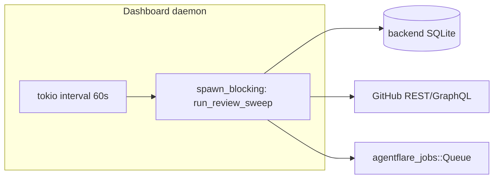
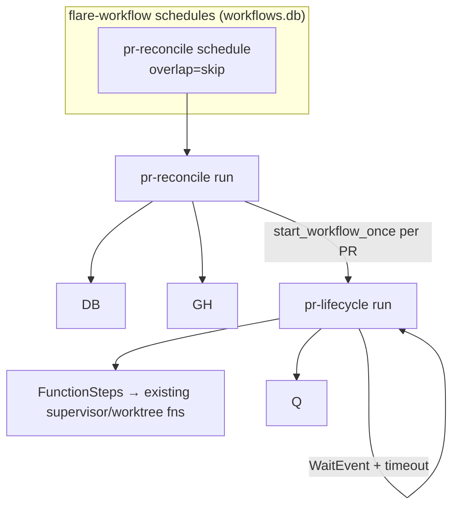

# PR lifecycle on `flare-workflow` (v1 design spec)

| Field | Value |
|-------|-------|
| Item | #395 — design-spec only (no application code in this item) |
| Status | Draft for implementation planning (rev 2 — reviewer gap pass) |
| Informed by | PM handoff (item asset), `run_review_sweep` / `review_bots` audit, flare-workflow scheduling (#366) |
| Related | #393 (workflow engine reliability), #939/#944 (`needs_input` + verify gate at `item_done`), bridge work-item pipeline (`.superpowers/notes/bridge-work-item-workflow-design.md`) |

## Deliverable and acceptance (item #395)

| Criterion | This item |
|-----------|-----------|
| **What ships** | This markdown file, **tracked in git** under `docs/superpowers/specs/` |
| **What does not ship** | Rust changes, workflow handlers, daemon wiring, or green CI on unchanged production code |
| **Done when** | Spec merged on the task branch (or main) with a commit that adds/updates only design docs (+ `.gitignore` carve-out if needed) |
| **Implementation follow-up** | Separate items from §Follow-up; gated on #393 for `engine = workflow` default |

**Reviewer note (prior round):** An earlier pass authored this spec on disk but left `git diff master` empty because `/docs/` was fully gitignored — the file never entered version control. That is **not** a substitute for the deliverable. Verification for #395 is **git-tracked design docs**, not `cargo test` on unchanged Rust.

### Round-2 response (completion gate)

| Reviewer finding | Response |
|------------------|----------|
| No committed changes vs `master` | `.gitignore` carve-out for `docs/superpowers/**` plus this spec are on branch `task/395-design-spec-pr-lifecycle-workflow-replac` (commit `ff8afa94` and follow-ups). |
| “Passing tests” ≠ design deliverable | Item metadata `task_type=design-spec` — acceptance is the spec file and parity/scheduling analysis, not supervisor behavior changes. |
| “Implement the requested scope” | Implementation is **out of scope for #395**; §Follow-up lists concrete Rust items. This round adds **code-backed** schedule/engine integration notes (#366) missing from rev 1. |

**#395 verification (run synchronously before marking done):**

```bash
git diff master --stat   # expects .gitignore + docs/superpowers/specs/pr-lifecycle-workflow-v1.md
git ls-files docs/superpowers/specs/pr-lifecycle-workflow-v1.md  # must print the path
```

## Summary

Replace the monolithic 60s supervisor tick (`spawn_supervisor_review_sweep` → `run_review_sweep`) with **two durable workflows** on the existing `flare-workflow` engine:

1. **`pr-reconcile`** — one scheduled reconciler per scheduling scope (see **Scheduling recommendation**) that performs batch GitHub/DB work and fans out per-PR work.
2. **`pr-lifecycle`** — one durable run per open PR (`start_workflow_once`), executing the same decision tree as today’s `handle_pr_status` / `handle_ci_green` paths without rewriting business logic.

v1 **wraps existing Rust functions** as `FunctionStep`s. CodeRabbit / `[review_sweep].review_bots` behavior stays as-is. **pr-agent** (Python tooling) is a later optional port for algorithms and an optional `/describe` CLI step — not a v1 dependency and not a CodeRabbit replacement.

## Goals

- **Durable per-PR state** so a daemon restart mid-sweep does not lose in-flight reasoning about a PR (journal + `start_workflow_once` receipts).
- **Observable progress** per PR via workflow run status instead of opaque tick logs.
- **Parity** with every `PrCiStatus` branch and discovery/stray-heal paths in `run_review_sweep`.
- **Safe cutover** behind `[review_sweep].engine = tick | workflow` with tick mode unchanged as default.

## Non-goals (v1)

- Embedding or running pr-agent’s Python stack in the supervisor process.
- Replacing CodeRabbit or reimplementing `review_bots.rs` thread logic in agents.
- One cron / schedule row per PR (reconciler fans out instead).
- Rewriting `handle_pr_status` logic — only relocating orchestration.
- Changing bridge claim/discovery (`run_discovery_tick`) or work-item SDD pipeline (# bridge note).

## Current state



`run_review_sweep` (`src/supervisor.rs`) per registered project:

1. `collect_review_batches` — list `in_review` items, stray candidates, labels.
2. Optional stray restore (`stray_pr_is_still_relevant` + `update_state`).
3. `discover_untracked_prs` for trusted-author PRs without items.
4. Batch GraphQL `batch_pr_status_chunked` for numbered PRs; REST fallback for unnumbered.
5. Per item: `reconcile_armed_auto_merge`, `pending_if_ci_running`, `handle_pr_status`.

Concurrency guards today: item **claim** moves item out of `in_review` during self-repair; `self_repair_or_gate` re-checks claim liveness; cap counters on marker comments.

## Target architecture



### Workflow definitions

| `workflow_id` | Trigger | `start_key` | Purpose |
|---------------|---------|-------------|---------|
| `pr-reconcile` | Schedule row per `repo_root` (`every_secs` ≥ `MIN_EVERY_SECS` = 60) | **`schedule:{occurrence_id}`** — owned by #366 driver (`start_key_for`), not a custom prefix | Batch enumerate, discover, fetch CI snapshot, fan-out |
| `pr-lifecycle` | Reconciler `FunctionStep` (and manual debug) | `pr-lifecycle:{project_id}:{item_id}:{pr_number}` on the **PR Rust engine** (see below) | Act on one PR/item until quiescent or waiting |

Schedule fires inject `params.schedule` (`schedule_id`, `occurrence_id`, `slot`, …) per `src/schedule/tick.rs`; reconciler steps read `repo_root` from the schedule row and `folder_path` from params, not from a bespoke reconcile key.

**Scope id (`scope_id`)** — deprecated in favor of `repo_root` + schedule row; reconciler still iterates all `project_dirs` registered to that daemon.

### `pr-reconcile` steps (v1)

| Step | Type | Calls / behavior |
|------|------|------------------|
| `load_batches` | Function | `collect_review_batches` (extract shared entry from `run_review_sweep` or call thin wrapper) |
| `for_each_project` | Loop / orchestration | For each `ReviewBatch` in context |
| `restore_strays` | Function | Stray loop: `stray_pr_is_still_relevant`, `item::update_state` |
| `discover_prs` | Function | `discover_untracked_prs` (same args as today) |
| `fetch_status_batch` | Function | `batch_pr_status_chunked` + build map |
| `fan_out_lifecycle` | Function | For each in-review item with PR number: `start_workflow_once_with_params` → `pr-lifecycle` with payload `{ project_id, item_id, pr_number, folder_path, status_snapshot, labels, ... }` |
| `handle_unnumbered` | Function | Items without `metadata.pr.number`: start lifecycle with `status: Unknown` and let lifecycle call `pr_ci_status` REST path |

Reconciler **does not** call `handle_pr_status` directly in v1 — that moves to `pr-lifecycle`.

### `pr-lifecycle` steps (v1)

| Step | Type | Calls / behavior |
|------|------|------------------|
| `scope_mcp` | Function | `mcp.scoped_to_project(project_id, repo_root)` |
| `reconcile_auto_merge` | Function | `reconcile_armed_auto_merge` |
| `resolve_status` | Function | Use reconciler snapshot if fresh (`head_sha` matches); else re-fetch single PR (parity with unnumbered / stale snapshot) |
| `apply_pending_gate` | Function | `pending_if_ci_running` |
| `dispatch_status` | Function | `handle_pr_status(...)` — **unchanged signature** |
| `wait_or_complete` | Conditional | If result implies waiting on CI (`Pending` / `MissingCi` / external job): `WaitEvent` with timeout (e.g. 45–55s jitter) then `goto resolve_status`; else complete run |

**Note:** Steps that dispatch jobs (`self_repair_or_gate`, `coderabbit_repair_or_gate`) keep using `queue` + claim semantics; lifecycle run may end in `Completed` while job runs — reconciler must not start a overlapping lifecycle for the same key until terminal. Use `start_workflow_once` receipt + run status: while run is non-terminal, reconciler skips re-start (existing `Existing(run_id)` behavior).

For **CI-green paths**, `handle_pr_status` → `handle_ci_green` → `fetch_review_bot_state` / `merge_or_repair_findings` — no step split in v1.

## Scheduling recommendation

**Recommendation: one `pr-reconcile` schedule per `repo_root` (project folder), not one global schedule for all projects.**

| Option | Pros | Cons |
|--------|------|------|
| **Global reconciler** | Single schedule row; one tick coordinates everything | Must iterate all `project_dirs` anyway; one slow GitHub repo blocks journal for all; harder to tune interval per repo |
| **Per-`repo_root` schedule** (recommended) | Matches `schedules.repo_root` + `UNIQUE (repo_root, name)` schema; isolates failures; can disable sweep per project; aligns with workflow CLI mental model | N rows on multi-project daemons (typically small N) |
| Per-PR schedule | Fine-grained | Forbidden — N schedules, rate-limit storm, no batch GraphQL |

**Daemon wiring:** on boot, ensure schedule rows exist for each registered `project_dirs.folder_path` (create-or-update), `workflow_name = pr-reconcile`, `every_secs = 60` (or inherit env override), **`overlap = skip`**.

**Coexistence with today’s daemon:** `spawn_schedule_ticker()` already runs at dashboard boot (`src/dashboard/dispatch_boot.rs`) against `workflows.db`. v1 **reuses that ticker** — no second scheduler. When `engine = workflow`, disable the review-sweep tokio loop and rely on per-`repo_root` schedule rows named e.g. `pr-reconcile` with `overlap = skip`.

**Supervisor interval:** when `engine = workflow`, **disable** `spawn_supervisor_review_sweep` for that daemon; when `engine = tick`, keep today’s loop and do not enable reconcile schedules. **Never run both** for the same `repo_root` (see overlap table).

### Schedule ↔ Rust workflow integration (#366) — rev-2 finding

Today’s schedule **fire path only compiles JSON** workflows from disk (`resolve_named_definition` → `compile_workflow_in` in `src/schedule/tick.rs`). It uses a `WorkflowEngine<PipelineData>` instance **separate from** `work_item_pipeline::engine()` (`WorkItemData`), though both persist into the same `workflows.db` file.

`pr-reconcile` / `pr-lifecycle` must call existing supervisor Rust (`collect_review_batches`, `handle_pr_status`, …) as `FunctionStep`s — they **cannot** be v1 JSON agent pipelines.

| Approach | Verdict |
|----------|---------|
| JSON schedule workflow that prompts an agent to “run review sweep” | Reject — nondeterministic, no parity, no direct `Queue` access |
| Keep 60s `spawn_supervisor_review_sweep` but fan out `start_workflow_once` from inside `run_review_sweep` | Reject — does not meet “replace monolithic tick” goal; still one blocking sweep |
| **Builtin schedule names → pre-registered Rust `WorkflowDefinition`** on a dedicated PR engine | **Recommend for v1** |
| Second custom tokio loop duplicating `Scheduler::tick_once` | Reject — forks #366 |

**Recommended wiring (implementation item, not #395):**

1. Add `src/pr_lifecycle_workflow.rs` (name TBD) mirroring `work_item_pipeline.rs`: `PrLifecycleData`, `engine()`, `WORKFLOW_RECONCILE_ID = "pr-reconcile"`, `WORKFLOW_LIFECYCLE_ID = "pr-lifecycle"`, register both at dashboard boot when `review_sweep.engine == "workflow"`.
2. Extend schedule fire (or a small hook beside `spawn_fire`) so `workflow_name` **`pr-reconcile`** resolves to the builtin Rust definition instead of JSON — same occurrence/`start_key_for` semantics, `overlap = skip` unchanged.
3. Fan-out from reconciler’s `fan_out_lifecycle` step calls `pr_lifecycle_workflow::engine().start_workflow_once_with_params(...)` on the **same** engine that registered `pr-lifecycle` (not the JSON `PipelineData` engine).
4. Register #393 `on_terminal` on that engine (or shared callback) so `schedule_runs` rows converge when reconcile runs finish — same requirement as JSON schedules.

Until step (2) exists, `engine = workflow` must remain off in production even if definitions are registered.

## Identity and parameters

### `start_workflow_once` keys

```
pr-lifecycle:{project_id}:{item_id}:{pr_number}
```

- `project_id` — backend project UUID (matches `scoped_to_project`).
- `item_id` — item row id (stable across state changes except delete).
- `pr_number` — GitHub PR number from `metadata.pr.number`.

Receipt lifetime: permanent per key until eviction policy clears it — **v1 must define receipt cleanup** when PR merges or item leaves review (on `promote_merged_item` / `requeue_closed_pr_item`, delete receipt or use versioned key — see §8).

### Workflow params (JSON)

```json
{
  "project_id": "...",
  "item_id": "...",
  "pr_number": 123,
  "folder_path": "/abs/path/to/repo",
  "discovery_owner": "<stable_instance_id>",
  "status": "Passing",
  "status_payload": { "...": "serialized PrCiStatus fields" },
  "fetched_at": "2026-10-22T12:00:00Z"
}
```

Reconciler passes the best snapshot it has; lifecycle re-validates before mutating (same as today’s “live GitHub is authority” comments in `handle_pr_status`).

## Parity checklist

Legend: **R** = reconciler, **L** = lifecycle, **T** = today’s `run_review_sweep` / `handle_pr_status`.

| # | Behavior | Location today | v1 owner | Notes |
|---|----------|----------------|----------|-------|
| 1 | Multi-project isolation | `collect_review_batches`, `scoped_to_project` | R + L | Failed project skipped |
| 2 | Repo key mismatch skip discovery | `repo_matches_project` | R | Log same message |
| 3 | Stray in_review restore | stray loop | R | Only with live GitHub client |
| 4 | Untracked PR discovery | `discover_untracked_prs` | R | Counter `discovered` |
| 5 | GraphQL batch status | `batch_pr_status_chunked` | R | |
| 6 | Unnumbered PR REST status | `pr_ci_status` | L | |
| 7 | Armed auto-merge reconcile | `reconcile_armed_auto_merge` | L | Every pass |
| 8 | CI still running | `pending_if_ci_running` | L | May → WaitEvent |
| 9 | **Merged** | `promote_merged_item` | L | Clear lifecycle receipt on success |
| 10 | **Failing** | `disarm_our_auto_merge`, `self_repair_or_gate` | L | `RepairTrigger::FailingChecks` |
| 11 | **Passing** | `handle_ci_green` + `CiGreenMerge::Allowed` | L | Includes merge, approval gate, review bots |
| 12 | **AwaitingReview** | `handle_ci_green` + `BlockedOnReview` | L | |
| 13 | **Behind** | `update_stale_branch` | L | `updated` counter |
| 14 | **Conflicting** | disarm + `self_repair_or_gate` or `notify_conflict_gate` | L | `auto_resolve_conflicts_enabled` |
| 15 | **Closed** | `requeue_closed_pr_item` | L | |
| 16 | **Draft** | `mark_pr_ready` / wait if human re-drafted | L | |
| 17 | **Pending** | `nudge_paused_review_for_pending` | L | |
| 18 | **MissingCi** | `item_may_retry_missing_ci`, nudge, `retry_missing_ci`, disarm | L | |
| 19 | **Unknown** | skip | L | |
| 20 | Review bot threads | `review_bots.rs`, `fetch_review_bot_state` | L | Via `handle_ci_green` |
| 21 | Self-repair cap / silent retry | `self_repair_or_gate` | L | |
| 22 | No double dispatch in flight | claim + `already_gated_or_in_flight` | L | |
| 23 | `ReviewSweepResult` metrics | return struct | R aggregates lifecycle step outputs | Log same eprintln shape |
| 24 | Item in `needs_input` | N/A in sweep | N/A | `run_review_sweep` only lists `in_review`; verify/`needs_input` gate runs at `item_done` (#939/#944) **before** PR exists — out of lifecycle scope but must not be broken by receipt cleanup hooks |
| 25 | Stray `in_review` without live item | stray restore loop | R | Same `stray_candidates` path |
| 26 | Host pressure / quota on repair jobs | `host_policy` into `handle_pr_status` | L | Same `agentflare_resource_gate::Policy` argument |
| 27 | Telegram PR approval label | `PR_APPROVAL_LABEL` / `notify_pr_approval_gate` | L | Via `handle_ci_green` / merge gates |

### Boundary: work-item pipeline vs PR lifecycle

| Concern | Owner today | v1 owner |
|---------|-------------|----------|
| SDD / `agentflare-work-item` workflow | `work_item_pipeline.rs` | Unchanged |
| Open PR → merge / repair | `run_review_sweep` | `pr-reconcile` + `pr-lifecycle` when `engine = workflow` |
| `item_done` → `in_review` + PR metadata | `mcp_server::item` | Unchanged; lifecycle keys off `metadata.pr.number` |
| Completion verify evidence | `hook_completion_gate` / `item_done` | Unchanged; not invoked from review sweep |

### Registration shape (implementation hint)

Follow `work_item_pipeline.rs`, not `.agentflare/workflows/*.json` (those are agent/script workflows). Add e.g. `src/pr_lifecycle_workflow.rs` (name TBD) that:

1. Builds two `WorkflowDefinition`s with `FunctionStep` closures capturing `AgentflareMcp` + `Queue` (same boot pattern as `register_workflow(boot_definition)` in `dashboard/server.rs`).
2. Exports `sync_pr_reconcile_schedules(mcp, engine)` for daemon boot when `review_sweep.engine == "workflow"`.
3. Keeps workflow ids stable: `pr-reconcile`, `pr-lifecycle`.

### pr-agent audit (session) — v1 stance

External **[pr-agent](https://github.com/qodo-ai/pr-agent)** (Python PR toolkit) was reviewed as a **reference** for optional description/review automation — it is **not** vendored in agentflare and does not appear in `run_review_sweep` today. Production PR automation today is **Rust supervisor + CodeRabbit** (`src/supervisor/review_bots.rs`, `[review_sweep].review_bots` in config).

| pr-agent surface | What it does | agentflare today | v1 workflow stance |
|------------------|--------------|------------------|-------------------|
| `/describe` | LLM PR title/body from diff | No equivalent in sweep; humans/agents write PR text via `agentflare pr` | **Defer** — optional flagged CLI step after parity; not in `pr-reconcile` |
| `/review` | Inline review comments | **CodeRabbit** + `fetch_review_bot_state` / `merge_or_repair_findings` | **No swap** — keep `review_bots.rs` inside `handle_ci_green` |
| `/improve` | Suggested code edits | Self-repair jobs via `self_repair_or_gate` | **No swap** |
| `/ask` | Q&A on PR | Out of band (agents, Telegram) | N/A |
| Auto labels / changelog tools | Repo policy automation | Item labels + PM states | Defer — evaluate after lifecycle parity |
| Docker / GitHub Action runner | Host pr-agent in CI | agentflare daemon + jobs queue | **Do not** embed Python in supervisor (non-goal) |

**Conclusion:** pr-agent informs **future** optional steps (especially `/describe` for stale PR bodies). v1 lifecycle parity is defined entirely by existing `supervisor.rs` + `review_bots.rs` behavior; no pr-agent subprocess in the critical path.

## Overlap and double-dispatch policy

| Layer | Policy | Mechanism |
|-------|--------|-----------|
| Reconcile schedule | `overlap = skip` | `schedule_runs.status = skipped_overlap` |
| Concurrent reconcile fires | skip | SQLite schedule uniqueness |
| Same PR lifecycle | single flight | `start_workflow_once` → `Existing(run_id)` |
| Reconcile + lifecycle | Reconcile may call `start_workflow_once` while lifecycle running | **No-op** — do not enqueue second driver |
| Self-repair job + lifecycle | Job holds claim | Item not in `in_review` batch; lifecycle should exit early if item state ≠ in_review |
| Tick + workflow (misconfig) | **Forbidden** | `engine` mutual exclusion in daemon boot |

**Avoiding double repair:** keep `self_repair_or_gate` unchanged; lifecycle must not bypass `Dispatched` vs `Deferred`. If lifecycle completes while job runs, next reconcile tick skips item (not in batch) — same as today.

## Cutover: `[review_sweep].engine`

Add to `.agentflare/config.toml` (and document in guides):

```toml
[review_sweep]
engine = "tick"   # "tick" | "workflow"
```

| `engine` | Daemon behavior |
|----------|-----------------|
| `tick` (default) | Current `spawn_supervisor_review_sweep` → `run_review_sweep` |
| `workflow` | No review sweep tokio loop; register/sync per-`repo_root` `pr-reconcile` schedule; run schedule driver |

## Dependency on #393 (workflow reliability)

**Recommendation: soft gate on cutover, not on spec or handler scaffolding.**

| Track | Can proceed without #393 | Should wait for #393 |
|-------|--------------------------|----------------------|
| This spec + `WorkflowDefinition` registration | Yes | |
| FunctionStep wrappers + unit tests | Yes | |
| `engine = workflow` in production daemons | | **Yes** — schedule tick fallback, terminal callback → `schedule_runs`, orphan cancel semantics |
| Receipt cleanup on merge | | **Yes** — needs reliable terminal notification |

Rationale: hybrid track A+C — #393 hardens the scheduler; #395 defines PR semantics on top. Implement handlers behind `engine = workflow` flag but keep default `tick` until #393’s schedule driver is trusted in production.

## Migration phases

1. **Spec & registry** — Check in this doc; register `pr-reconcile` / `pr-lifecycle` definitions with no daemon wiring.
2. **Extract fan-out** — Thin `run_review_sweep` refactor: optional internal call path used only from tests to compare tick vs workflow orchestration (behavior-neutral).
3. **Schedule sync** — On daemon boot with `engine = workflow`, upsert per-`repo_root` schedules.
4. **Receipt lifecycle** — On merge/close/requeue, remove or rotate `start_key` (hook in `promote_merged_item` / `requeue_closed_pr_item`).
5. **Parity tests** — Port high-value supervisor tests to drive lifecycle workflow with mocked GitHub.
6. **Default flip** — After soak, change default `engine` to `workflow` and deprecate tick path.

## Observability

- Map `ReviewSweepResult` fields to reconciler run output JSON (structured log).
- Per-PR lifecycle: workflow run id in item `metadata.pr_lifecycle_run_id` (optional, debug).
- Alert on `schedule_runs.dispatch_failed` or frozen schedule (`frozen_error`).

## Follow-up implementation items

| Title | Depends |
|-------|---------|
| Register PR workflow definitions + FunctionStep harness | #395 |
| Builtin `pr-reconcile` resolution in schedule fire path | #366 + #395 |
| `review_sweep.engine` config + daemon gating | #395 |
| Schedule sync per `project_dirs` | #366 driver |
| `start_key` cleanup on terminal PR states | #395 |
| Parity test matrix from §7 | #395 |
| pr-agent `/describe` optional step (flagged) | Post-v1 |

## Open questions

1. **Receipt retention:** delete on merge vs TTL — prefer delete on merge + manual `workflow` CLI cleanup for stuck keys.
2. **Unnumbered PRs:** migrate items to always set `metadata.pr.number` at PR open to shrink REST fallback surface.
3. **WaitEvent timeout vs reconcile interval:** align lifecycle wait (~60s) with schedule `every_secs` to avoid redundant wakes.
4. **Frozen schedule on handler panic:** rely on #393 `frozen_error` + operator `workflow schedule` tooling vs auto-disable per `repo_root`.

## Verification matrix (for implementation items, not #395)

| Check | Command / signal |
|-------|------------------|
| Tick parity | Existing `supervisor` / `auto_merge` / `stray_pr` tests pass with `engine = tick` (default) |
| Workflow parity | New tests drive `pr-lifecycle` with mocked GitHub batch map; compare counters to `ReviewSweepResult` |
| No double driver | Integration test: `engine = workflow` boot does not call `run_review_sweep` on interval |
| Schedule isolation | Two `repo_root` rows; one repo’s `dispatch_failed` does not block the other’s `schedule_runs` |
| Receipt cleanup | After `promote_merged_item`, `start_workflow_once` can start a fresh run for a future PR on same item id |

## References (code)

- `src/supervisor.rs` — `run_review_sweep`, `handle_pr_status`, `collect_review_batches`
- `src/supervisor/merge.rs` — `handle_ci_green`
- `src/supervisor/review_bots.rs` — CodeRabbit / review bot repair
- `src/supervisor/auto_merge.rs` — `reconcile_armed_auto_merge`
- `src/worktree/mod.rs` — `PrCiStatus`
- `src/dashboard/server.rs` — `spawn_supervisor_review_sweep`
- `src/dashboard/dispatch_boot.rs` — `spawn_schedule_ticker`
- `src/schedule/mod.rs` — `start_key_for`, `MIN_EVERY_SECS`
- `src/schedule/tick.rs` — schedule fire + JSON compile path
- `crates/flare-workflow` — schedules, `start_workflow_once_with_params`, `overlap`
